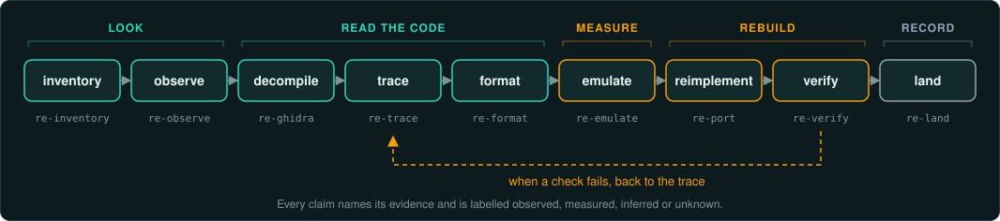

# GameFrame

GameFrame is an agentic framework for reverse engineering games. Its playbook of skills and agents runs inside your coding agent. Its toolkit of tested tools checks every result against the original. AI agents and people use it to study a game from its shipped files. They
document its formats and rules, and reimplement it so it behaves exactly like the original.

The toolkit works with [Ghidra](https://ghidra-sre.org), the
[Unicorn](https://www.unicorn-engine.org) emulator, [REA](https://github.com/morluto/rea)
(Reverse Engineer Anything) and, for DOS games, [DOSBox-X](https://dosbox-x.com) and its
debugger. GameFrame grew out of [Un-Banished](https://github.com/tanepiper/unbanished), a 1:1
reimplementation of the game Banished built this way; see
[the case studies](docs/case-studies/README.md).

## Set it up with your agent

Copy this prompt into your coding agent (Claude Code, Codex, Cursor or another). It clones
GameFrame and checks your tools. It asks before it installs anything, then starts a project for
your game.

<!-- #region setup-prompt -->
```text
Set up GameFrame on this computer for me.

1. Clone https://github.com/tanepiper/game-frame into ~/code/game-frame
   (or update it with git pull if it is already there).
2. Read AGENTS.md and skills/re-setup/SKILL.md.
3. Run scripts/setup.sh and show me the table of what is present and what is missing.
4. Before you install anything, tell me what scripts/setup.sh --install will install and how
   large each part is. Wait for my answer, then run it.
5. Run tests/run.sh --ghidra and report how many checks passed. If any failed, show the
   failures and fix the setup before going on.
6. Run scripts/setup.sh --rea and help me register REA with this agent.
7. Ask me for the name of the game and the folder of my own copy of it. Then run
   scripts/new-project.sh ~/re/<short-name> "<Game Name>" "<path to the game>".
8. Open the new project, read its AGENTS.md, and start with the re-start skill.

Never copy the game's files, extracted assets or decompiled code into a git repository.
```
<!-- #endregion setup-prompt -->

To set it up by hand instead, follow the [quick start](#quick-start).

## Framework, playbook and toolkit

GameFrame is the whole framework. It has two parts.

The **playbook** is the method and the rules an agent follows:

- the skills in `skills/re-*/`, one per step of the method;
- the stage agents in `agents/`, packaged with the skills as a Claude Code plugin
  (`.claude-plugin/`);
- the rules in `AGENTS.md` and, for each game, in the project's own `AGENTS.md`
  (`templates/project/`).

The **toolkit** is the tested tools the playbook runs:

- the tools in `tools/`, such as the Ghidra export and query, the Unicorn emulators, format
  validation and the bit-exact comparison tools;
- the scripts in `scripts/`, such as setup, new-project and the Ghidra runs;
- the checks in `tests/run.sh`, which prove every tool on the samples in `examples/`.

## Quick start

```bash
git clone https://github.com/tanepiper/game-frame.git
cd game-frame
scripts/setup.sh --install          # Ghidra, JDK 21, objdump, Node, Zig, and .venv (unicorn, pefile, capstone)
tests/run.sh --ghidra               # proves every tool on the sample game (about 1½ minutes)

scripts/new-project.sh ~/re/mygame "My Game" "/path/to/My Game"   # a project for one game
```

Then open the new project with your agent and ask it to start with the **re-start** skill.
The skills follow the Agent Skills format (https://agentskills.io). There is one copy, in
`skills/`. The links `.claude/skills` and `.agents/skills` point to it, so Claude Code,
Codex, Gemini CLI, GitHub Copilot, Cursor and OpenCode find the skills without setup. Agents
that do not read skill folders read `AGENTS.md` and the `SKILL.md` files. On Windows, git makes the links
only with symbolic links turned on (`git clone -c core.symlinks=true`, with Developer Mode);
without them, point the agent at `skills/`.

### As a Claude Code plugin

The skills and the stage agents are also a Claude Code plugin. In Claude Code:

```text
/plugin marketplace add tanepiper/game-frame
/plugin install gameframe@game-frame
```

The plugin brings the skills, the agents, the gates and the MCP servers in `.mcp.json`. A
project made with `scripts/new-project.sh` enables it in its `.claude/settings.json`, with
auto-update on, and runs the toolkit through its own `./gameframe` launcher, which finds
GameFrame in a clone or in the plugin's install. `plugin.json` carries the release's version.
Claude Code updates the plugin when that version changes, so projects move from one release to
the next. Each release raises the version and tags the commit with it. A project's own
tools and scripts sit beside the launcher, and GameFrame never touches them.

## Find your way with `gameframe`

`./gameframe` is a small command for help and discovery. It reads the skills and the tools'
own help from the files, so it never goes out of date. It needs only Python 3. Every new
project gets a small launcher of the same name, which runs this command and the toolkit on the
project (`./gameframe run NAME`, `./gameframe python FILE`, `./gameframe root`).

```bash
./gameframe steps                      # the method's loop, each step with its skill
./gameframe skills                     # every skill in one line
./gameframe skill re-trace --sections  # a skill's headings; --section TITLE prints one part
./gameframe tools                      # every tool and script, with its first line of help
./gameframe tool decomp_query          # one tool's full help
./gameframe run peinfo target/game.exe # run a tool with GameFrame's .venv
./gameframe find vtable                # which skills and tools mention a word
./gameframe advise "<error text>"      # known failures, fixes and dead ends (docs/knowhow/)
./gameframe doctor                     # the toolchain check (scripts/setup.sh)
```

`steps`, `skills`, `tools`, `tool` and `find` also print JSON with `--json`, for agents and
scripts.

## The method



Write each claim with its evidence (an address, a value, a measurement) and one label:
*observed*, *measured*, *inferred* or *unknown*. Measure each number the reimplementation must match by running the original function under the emulator. The reimplementation must give the same result bit for bit.

## Skills

Each skill is a self-contained guide for one step: when to use it, exact commands, what evidence
to produce, and the pitfalls that cost time.

| Skill | Step |
|---|---|
| [re-start](skills/re-start/SKILL.md) | Rules, the loop, a first-session checklist, routing to the other skills |
| [re-setup](skills/re-setup/SKILL.md) | Install and check the toolchain; register REA for your agent |
| [re-inventory](skills/re-inventory/SKILL.md) | Which files hold the game's code; native, managed, scripted or packed; engine and middleware; data containers; what kind of game it is; the story from the manual and the program's text, in `docs/lore.md` |
| [re-browse](skills/re-browse/SKILL.md) | A resource viewer from day one: the catalogue of every file (`catalog.py`), then the project's own viewer on the port's readers, for people and agents to check decoded content |
| [re-observe](skills/re-observe/SKILL.md) | Run the original where you can watch, drive and capture it; every input; every screen; an object model with entry points for tests and agents |
| [re-rea](skills/re-rea/SKILL.md) | When to use REA's MCP tools, and how they fit with the text export |
| [re-ghidra](skills/re-ghidra/SKILL.md) | Headless export, queries, one-off decompiles, vtables, constants, checking the disassembly |
| [re-trace](skills/re-trace/SKILL.md) | From a string, import, export or class name to the function, its fields and constants |
| [re-format](skills/re-format/SKILL.md) | Decode archives, resources and saves; prove decoders on every file |
| [re-emulate](skills/re-emulate/SKILL.md) | Run original functions under Unicorn for ground truth; trace random draws |
| [re-port](skills/re-port/SKILL.md) | Reimplement exactly: precision, order of operations, draw order, iteration order; an exact core with commands, digests and a headless runner; additions (multiplayer, mods) kept apart |
| [re-verify](skills/re-verify/SKILL.md) | Bit-exact parity, draw order, determinism with digests and on every platform, recordings, saves, pictures, version against version, test tiers |
| [re-land](skills/re-land/SKILL.md) | Document in evidence style, label, commit safely |
| [re-site](skills/re-site/SKILL.md) | The project's website in `sites/`: a diary entry per milestone, the documents shown as pages with `@include`, no commit dumps and no game material |

## Stage agents

One agent per stage of the method, in [agents/](agents/). Each has its skills preloaded, does only its
stage and ends with a hand-off that names the next agent. The main session sends them one at a
time; only the lander commits. `re-start` ("Stage agents") has the table of hand-offs.
[Permissions and gates](docs/working/gates.md) lists what runs without asking and the hooks
that block game material, decompiled code and commits by other agents.

`re-surveyor` → `re-observer`, `re-decompiler` → `re-tracer` → `re-decoder`, `re-measurer` →
`re-porter` → `re-verifier` → `re-lander`, and back to the tracer or the porter when a check
fails.

Twelve task agents do one job each, in any stage: `re-identifier` (engine and libraries),
`re-randomiser` (random generators and draw order), `re-listener` (every input),
`re-cataloguer` (every screen), `re-mapper` (hardware and memory), `re-typer` (structures and
classes), `re-matcher` (a crate or
library against the game), `re-editor` (documents to the writing rules), `re-checker`
(claims and sources), `re-publisher` (the project's site and diary), and two hardware
specialists, `re-vectoriser` (MMX and other SIMD code) and `re-accelerator` (the 3D card
APIs). `re-start` ("Task agents") has their table.

Claude Code, Cursor and VS Code read the agents in `agents/` (through `.claude/agents`). Codex,
Gemini CLI, GitHub Copilot and OpenCode read copies in their own formats, which
`gameframe agents --emit all` writes. A client without subagents takes each role in one
session. [Agents in every client](docs/working/agents.md#agents-in-every-client) has the support
matrix.

[Agent teams](docs/teams/README.md) shows how the agents work together: seven teams for
common pieces of work (start-up, an exact system, a data format, the main loop, the interface,
sound and hardware, documentation), each with a diagram of its hand-offs, the data passed
between agents, the outcome, and the failure path.

## Scripts

| Script | What it does |
|---|---|
| `scripts/setup.sh [--install] [--rea]` | Checks every tool; installs what is missing; shows REA's registration plan |
| `source scripts/env.sh` | Sets `GAMEFRAME_ROOT`, loads `.env`, puts `gameframe` and the `.venv` Python on `PATH`, for each shell or agent session |
| `scripts/new-project.sh DIR "Name" [GAME] [--copy] [--agent LIST]` | Creates a project for one game: rules, the plugin enabled, the `./gameframe` launcher, ignored folders for the game and its derivatives. `--copy` copies the toolkit, skills and guides instead. `--agent` names the coding agents to set it up for (`claude,codex,gemini,copilot,cursor,opencode`, or `all`, the default): each gets its skill link, agents, gate hooks and MCP servers |
| `scripts/update-project.sh DIR [--plugin] [--agent LIST] [--dry-run]` | Keeps a project current. For a plugin project, refreshes the launcher, settings and each agent's files. For a copied project, adds what is missing, replaces older copies and keeps the project's own edits; `--plugin` moves it to the plugin and removes only GameFrame's own files. `--agent` adds agents; without it, the agents the project already has are refreshed |
| `scripts/new-site.sh NAME "Title" ["Description"] [--single] [--repo URL]` | Starts a project's website in `sites/NAME/` (or `site/`): the front page, the diary, the findings and status pages through `@include`, and a GitHub Pages workflow (`re-site`) |
| `scripts/ghidra-export.sh [--labels FILE] BINARY...` | Headless Ghidra analysis and a text export: pseudocode, functions, strings, imports, exports; names applied from a labels file |
| `scripts/ghidra-run.sh BINARY decompile\|named\|refs\|vtable\|labels\|callargs\|blocks\|disasm\|fill-gaps OUT ARGS` | One-off jobs in the analysed project, without re-analysis: also every call with its arguments (`regs=watcom` for register arguments), raw memory pieces, and `fill-gaps` to make the functions `exportcov` finds and export again |
| `scripts/extract-installer.sh [--detect] INSTALLER OUT` | Unpacks an installer or package without running it: Inno Setup (GOG), NSIS, InstallShield, MSI, archives, `.dmg`, `.pkg`, GOG's `.sh`, CD images |
| `scripts/zcc.sh` | rustc's linker for 32-bit Windows DLLs through `zig cc`, with no MinGW, exporting exactly the names in a `.def` file: replacement libraries a 1990s game imports by name |
| `scripts/dosbox-run.sh [--fileio] [--break] [--mcp PORT] DIR PROGRAM` | Runs a DOS program in DOSBox-X without a window: exit code, file I/O log, debugger control |
| `./gameframe COMMAND` | Help and discovery: the steps, the skills, every tool's own help; runs a tool with the `.venv` |
| `tests/run.sh [--ghidra]` | 183 checks of every tool against the two sample games, and more with `--ghidra` |

## Tools

| Tool | What it answers |
|---|---|
| `tools/disc/discinfo.py` | A CD image (CUE/BIN, ISO): tracks, CD audio, Mode 2 sectors, ISO 9660, Joliet, HFS, El Torito, dates; copies files and audio out |
| `tools/triage/filetypes.py` | What each file is from its bytes: signature, entropy, compressed or packed |
| `tools/triage/similar.py` | How much two files or two releases share, even when they differ; renamed files |
| `tools/triage/binview.py` | A file drawn as a picture, one pixel per byte, by kind of byte or by entropy |
| `tools/triage/tables.py` | Sine and cosine lookup tables, with their steps, scale, type and rounding |
| `tools/triage/sigscan.py` | Byte signatures with wildcards: make them from named functions, find them in another build or a game |
| `tools/triage/insns.py` | Every instruction of a kind: port access, interrupts, timers, divisions |
| `tools/triage/buildid.py` | Which build a copy is: the disc's mastering date, each executable's link date and VERSIONINFO, version strings, readme and setup version lines; written into `docs/versions.md` |
| `tools/triage/versiondiff.py` | Two editions compared, as folders or disc images read in place: files added, removed and changed by folder, the executables' link dates, the languages; Markdown for `docs/versions.md` |
| `tools/triage/exportcov.py` | How much code a Ghidra export covers, its largest gaps, and the likely starts of the functions it missed, for a batch decompile |
| `tools/triage/refs.py` | Every instruction that refers to an address, found in the raw code bytes (32-bit and RIP-relative), read, write or value, with hits in no function marked |
| `tools/triage/pointerpaths.py` | A chain of pointers from a global to a value that moves between runs |
| `tools/triage/coverdiff.py` | The code that ran only with an action: two coverage logs (drcov or address lists) compared, by function |
| `tools/triage/fixity.py` | A BagIt bag of a game copy with checksums; manifests in place; verification over time |
| `tools/triage/constants.py` | Random generators, checksums, hashes, ciphers and decompressors named by their constants, with addresses; Park–Miller when its modulus is beside its multiplier |
| `tools/triage/sentences.py` | The sentences in a program or a Ghidra `strings.txt`: messages, descriptions and notes, for reading the game's story (`docs/working/lore.md`) |
| `tools/triage/hashnames.py` | Which hash function names things, and the name behind each hash constant |
| `tools/triage/match_functions.py` | The same functions in two builds, from two Ghidra exports; your labels carried to the new addresses |
| `tools/triage/memscan.py` | Where a running game keeps a value, from memory dumps taken as it changes; pointers to it |
| `tools/triage/axes.py` | Which axis is up in a 3D game, its sign, and the handedness, from a recorded path over the level's vertices |
| `tools/triage/compare_trees.py` | Two copies or releases compared file by file (SHA-256, case-insensitive paths); hashes to publish |
| `tools/pe/peinfo.py` | What is this binary: architecture, compiler, PDB path, imports, exports, RTTI, engine and packer fingerprints |
| `tools/pe/probegen.py` | A probe library for a DLL a 32-bit game imports: the same export names, and a log of every call with its arguments |
| `tools/pe/peres.py` | Version information, string tables, dialogs, bitmaps and data inside a Windows executable |
| `tools/pe/stackstrings.py` | Text the code builds on the stack, which no string list shows |
| `tools/pe/readdata.py` | The real value of a `DAT_` constant or table |
| `tools/pe/vtable.py` | The functions in a table of function pointers |
| `tools/pe/relocs.py` | The pointers in a PE's data, from its base relocations: vtables and tables of functions, strings and records |
| `tools/triage/screenmarks.py` | Marks positions read from memory on a screenshot, through the camera's view and projection matrices |
| `tools/triage/dates.py` | Dates and times in a file, in nine stored forms (Unix, FILETIME, DOS, HFS, OLE, ISO 9660, SYSTEMTIME), near a date you give |
| `tools/live/memrec.py` | Snapshots of a running game's writable memory for `memscan.py`, and recordings of named values as JSON Lines, from `/proc/PID/mem` (Wine on Linux, or in a VM); `--wait` starts at a phase |
| `tools/live/shot.py` | A capture of the screen, a window or a file kept under a name of its own in `derived/captures/DATE/`, with its text, never overwritten |
| `tools/live/modfolder.py` | Installs a folder of changed files into a game's install folder, lists it and takes it out again, with no stale files |
| `tools/live/emupc.py` | Writes an emulated PC for the original: QEMU, a Debian cloud image, cloud-init with Wine and 32-bit Mesa, Xvfb and openbox, SSH, the disc as a CD-ROM |
| `tools/live/memlog.py` | Reads a `memrec` recording back: a summary of ranges and changes, CSV with arrays split and 16.16 values as decimals, or the sample nearest a time |
| `tools/live/emulock.py` | A note of who uses a shared emulator or VM, since when and for what; a second session is refused and told who holds it |
| `tools/live/loopcut.py` | Cuts a recorded path at its first return to the start, so a racing line or patrol is one closed loop; refuses a path shorter than a loop |
| `tools/live/winput.py` | Keys, mouse moves and clicks sent to a game from inside Wine with `SendInput`, for macOS, where synthetic input needs a permission and Wine windows belong to no app. Builds `winput.c` with zig |
| `tools/live/align.py` | Lines up a known picture of a screen with a capture of it now (window frame, title bar, scale) and maps click points between them, with a picture to check before clicking |
| `tools/live/harness.py` | Puts together the modules a game needs from `docs/harness/modules/`: a runtime, a layer for each need, the gaps, and the set-up steps as one script to read |
| `tools/triage/needs.py` | What a game needs to run, from an executable, a folder or a disc image: CPU features, OS, graphics and sound APIs, libraries, extenders, DRM and media, each with its evidence |
| `tools/formats/pngio.py` | Reads and writes PNG pictures with the standard library alone |
| `tools/live/frida_trace.py` | Calls to chosen functions, and accesses to chosen memory, in a running game, with Frida. Calls use the same format as the emulator's call traces |
| `tools/emu/mem_trace.py` | Which instructions read and write chosen memory while an emulated function runs. It is the first step of taint analysis |
| `tools/triage/decomp_query.py` | A function with your labels; callers; callees; who uses a string; who writes a field; where the work is |
| `tools/triage/decomp_query.py layout` | A structure's fields from the functions that use it, merged, with a draft C struct |
| `tools/triage/cite_labels.py` | Function labels made from the port's own `Original: FUN_…` citations, for the decompiled code |
| `tools/triage/dictionary.py` | Checks the data dictionary (`labels/dictionary.tsv`) against the kinds, the evidence labels and `labels/fields.tsv`, and prints it as a table |
| `tools/triage/deviations.py` | Every `Deviation:` and `not ported` comment in the reimplementation, as one ledger; `--check` for tests |
| `tools/triage/coverage.py` | How much of the original (by count and by size) the reimplementation cites, and the largest functions nobody cites yet |
| `tools/emu/pe_emu.py` | Call any function of a Windows x64 EXE or DLL with chosen inputs and read the result |
| `tools/emu/pe32_emu.py` | Call a routine of a 32-bit (x86) Windows EXE or DLL, with arguments on the stack or inputs in registers, MMX and x87 included; each import stops the run with its name |
| `tools/emu/call_trace.py` | The calls an emulated function makes (random draws), in order, with call sites |
| `tools/formats/reader.py`, `validate.py` | Prototype a format decoder; prove it consumes every byte of every file, and with `--write` that every file writes back identical |
| `tools/formats/derived.py` | Which unexplained fields next to geometry are computed from it: bounds, centres, Newell and cross-product normals, plane distances |
| `tools/formats/xorscan.py` | The key of a simply obfuscated file: XOR, add, stepping and chained keys; a key XORed into one field of every directory record, from the names' zero padding, found again in the executable |
| `tools/formats/rawimage.py` | Raw pixels to PNG: VGA 13h, Mode X, EGA planes, CGA, packed and 16-bit, with palettes (6-bit values scaled or shifted, `--dac`) |
| `tools/formats/shadetable.py` | A palette game's shade, fog or light table: the black, unchanged and white levels, the colour it fades toward, a picture |
| `tools/formats/markers.py` | Unique values planted in a file's fields, then found in memory dumps |
| `tools/dos/omf.py` | OMF object files and libraries (.OBJ, .LIB): publics, and signatures of the runtime for `sigscan.py` |
| `tools/formats/pcap.py` | A network capture (pcap, pcapng) split into flows and messages, or joined into TCP streams |
| `tools/formats/fields.py` | Many records or messages side by side: constants, counters, lengths and types, and a heatmap |
| `tools/formats/skeleton.py` | Skeletons in a model file: parent index arrays as trees, runs of quaternions, joint names |
| `tools/formats/shaders.py` | Shaders inside a file: Direct3D 9 bytecode, DXBC, DXIL, SPIR-V, GLSL, HLSL and ARB, with their names |
| `tools/formats/swfinfo.py` | A Flash game: SWF version, compression, ActionScript version, classes, content; the movie inside a projector |
| `tools/formats/timestamps.py` | A number read as every common timestamp; timestamps found inside a file |
| `tools/verify/bitcompare.py` | Ground truth against reimplementation, bit for bit, with ULP distance |
| `tools/verify/ramdiff.py` | Memory frame by frame from the original and the port: the first frame and address that differ, named from a RAM map |
| `tools/verify/seqdiff.py` | The first random draw (or any event) where two traces differ |
| `tools/verify/replay.py` | A port's trace against a recording read from outside: a value passes when any state in its sample's window holds it |
| `tools/site/check.py SITE_DIR` | Checks a project's site before it is published: no game files or decompiled code, includes that resolve, diary entries with a title and summary that do not read like a commit log |
| `tools/ghidra/*.java` | The Ghidra scripts the shell scripts run (`ApplyLabels.java` names functions and creates missed ones) |
| `tools/dos/dosinfo.py` | What is this DOS binary: MZ, NE or LE; segments with Ghidra's selectors; imports; compiler, extender, packer fingerprints; debug symbols; Pascal strings |
| `tools/dos/tdinfo.py` | Borland Turbo Debugger symbols: original procedure, global and type names, parameters, record layouts, source lines, labels for Ghidra, Rust readers for records |
| `tools/dos/nedis.py` | 16-bit disassembly with relocations applied: far calls and DS globals by name |
| `tools/dos/readseg.py` | Typed values at `seg:off`, including Turbo Pascal `Real` and Pascal strings |
| `tools/emu/dos_emu/` | Call any function of a 16-bit NE (protected mode) or MZ (real mode) program, at Ghidra's addresses |
| `tools/emu/dos_env/` | A small DOS, BIOS, DPMI host and PC for dos_emu: run a whole DOS program headless, with files, timer interrupts, keys, and screenshots |
| `tools/emu/fragments.py` | Capture fragments of a DOS program's main loop from one headless run: DS, stack, screens, open files and heap blocks before and after each fragment, for the port's tests |
| `tools/dos/fileio_trace.py` | From a DOSBox-X file log: every file's reads in order, with record patterns |
| `tools/dos/dbx_control.py` | Drive DOSBox-X's debugger from a script: breakpoints, registers, memory |

The tools in `tools/llm/` call Claude with an API key, so they spend Claude Platform credits,
such as a Max or Team plan's monthly credits ([API credits](docs/working/api-credits.md)).

| Tool | What it does |
|---|---|
| `tools/llm/name_functions.py` | A suggested name, signature and summary for every unnamed function in a Ghidra export, in one Message Batch, written to `analysis/` for you to confirm |
| `tools/llm/skillcheck.py` | Gives an agent one skill and a task on the sample game, and checks its answer against the ground truth: is each skill enough on its own? |
| `tools/llm/headless.py` | Runs one of GameFrame's agents unattended under a budget and saves its report; `docs-check` runs `re-checker` and `re-editor` over the documents |
| `tools/llm/locate.py` | Finds a screen element, or a reference screen, in a capture by asking a model, when `align.py` cannot line them up |
| `tools/llm/ask.py` | A question answered from the know-how entries `gameframe advise` finds, naming each entry it uses |
| `tools/llm/client.py` | The shared client; run it to check the SDK, the key and the `claude` command |

## Crates

Clean Rust implementations of chips and runtimes that many old games need, each checked against
an original program in one of the case studies. They live in `crates/`, a Cargo workspace,
under Apache 2.0. See [docs/crates](docs/crates/README.md).

| Crate | What it is |
|---|---|
| [gameframe-opl2](crates/opl2/README.md) | The YM3812 (OPL2) FM chip of the AdLib and Sound Blaster, with a resampler |
| [gameframe-wma](crates/wma/README.md) | A WMA v2 decoder for xWMA and ASF streams, building for WebAssembly |
| [gameframe-msvc-crt](crates/msvc-crt/README.md) | MSVC's `sinf`, `cosf`, `acosf`, `atan2f`, `qsort` order and `rand`, bit for bit |
| [gameframe-turbo-pascal](crates/turbo-pascal/README.md) | Turbo Pascal's 6-byte `Real`, `Random` and Pascal data layouts |

## Worked example

[examples/sample-game](examples/sample-game) is a tiny Windows x64 game (an EXE and an engine
DLL, built from C with Zig on any host) with the parts real games have: a fixed-step update, a
random number generator, a constant table, objects with a vtable, and a data file. It comes with
a ground-truth script, a reimplementation that matches the original bit for bit on 20 seeds,
and a deliberately naive reimplementation (doubles instead of floats) that the checks catch.

[examples/dos-sample](examples/dos-sample) does the same for DOS: 16-bit Pascal-style code
assembled with Zig and linked by our own script into an NE program (with Borland debug
symbols), and a real-mode MZ program, checked under the emulator and under DOSBox-X.

## Documents

The documentation is in [docs/](docs/README.md). It is also built as a website
(`npm --prefix site run dev`; see [site/README.md](site/README.md)).

- **[A taxonomy of games](docs/games/README.md)**: who drives (the game or the player), the axes
  every game sits on, ten families from arcade action to online games, each with a rule set,
  reference games and projects to learn from, and the systems they share.
- **[Software engines and middleware](docs/engines/README.md)**: how to recognise an engine,
  the id, Build and Unreal engines, other licensed and studio engines, and middleware.
- **[Hardware of the era](docs/hardware/README.md)**: CPUs from the 8086 to SSE2, fixed point
  and the x87 FPU, VGA and Mode X, 3dfx and the other 3D cards, sound cards and FM synthesis.
- **[Console games](docs/consoles/README.md)**: the platforms from the NES to the sixth
  generation, the tools, the routes to a port, and matching decompilation.
- **[Working on a project](docs/working/README.md)**: how agents work well on this, and how to
  write findings in plain English.
- **[Observing the original](docs/observe/README.md)**: running the original, every kind of
  input, capturing the interface, and an object model with entry points for tests and agents.
- **[The harness](docs/harness/README.md)**: what a game needs to run, the modules that
  provide it (runtimes such as Wine, an emulated PC and DOSBox-X; layers such as the Steam
  client), and how each game adds the modules it taught us.
- **[Case studies](docs/case-studies/README.md)**: Un-Banished, Tyrian 2000, Frontier: Elite II
  and POD: Planet of Death, and the tooling each built to capture its game.
- [docs/GAME-PATTERNS.md](docs/GAME-PATTERNS.md): main loops, random generators, entities,
  resources, saves, rendering, as they appear in machine code.
- [docs/DOS.md](docs/DOS.md): 16-bit DOS programs, Borland debug symbols, the DOS emulators.
- [docs/ABI.md](docs/ABI.md): calling conventions, C++ layout, floating-point and integer details
  that a bit-exact port must copy.
- [docs/TYPES.md](docs/TYPES.md): structures, classes, enumerations and the C++ standard
  containers, recovered from the code that uses them.
- [docs/OUTPUTS.md](docs/OUTPUTS.md): what a project can ship: documents, a website, programs
  for each system built by CI and attached to releases, a browser version, a server, tools.
- [docs/LEGAL.md](docs/LEGAL.md): working from your own copy, sharing none of the game's files,
  and writing new code from documented behaviour.
- [docs/SETUP.md](docs/SETUP.md): the toolchain, and tools for targets beyond native code.

## Scope

Native Windows x64 games and 16-bit DOS games (MZ real mode, NE protected mode, Borland
Pascal and C) are covered end to end; 32-bit LE/LX DOS-extender games are recognised and run
in DOSBox-X, but have no loader or emulator here yet. 32-bit Windows games run under
`tools/emu/pe32_emu.py`, routine by routine. Linux and macOS binaries work with Ghidra and the
tools where they apply; the emulator needs a variant for them (`re-emulate` lists what changes). Managed (.NET, Unity), scripted and packed games are routed to the right
tools by `re-inventory`.

Use it on games you own, keep the game's files and anything derived from them out of
repositories, and write new code from documented behaviour: see [docs/LEGAL.md](docs/LEGAL.md).

## Licence

GameFrame uses two licences, one for each kind of work.

| What | Licence |
|---|---|
| **Code**: `tools/`, `scripts/`, `tests/`, `examples/`, `templates/`, `site/` (its configuration and code), `.claude-plugin/`, the Ghidra scripts | [Apache License 2.0](LICENSE-APACHE) |
| **Content**: the documentation (`docs/`), the skills (`skills/`), the agents (`agents/`, and their generated copies in `.codex/`, `.gemini/`, `.github/agents/` and `.opencode/`), the READMEs, `AGENTS.md` and `CHANGELOG.md`, and the website's text | [CC0 1.0](LICENSE-CC0-1.0), dedicated to the public domain |

CC0 1.0 gives up all copyright in the content, as far as the law allows. Anyone may copy,
adapt, translate and remix it for any purpose, commercial included, without asking and without
giving credit.

The screenshots in `docs/assets/case-studies/` show the games' own art. That art belongs to
the games' rights holders, is shown to illustrate the case studies, and is under neither
licence.

Projects made with `scripts/new-project.sh` start with the same two licences: Apache 2.0 for
their code and CC0 1.0 for their documentation.
