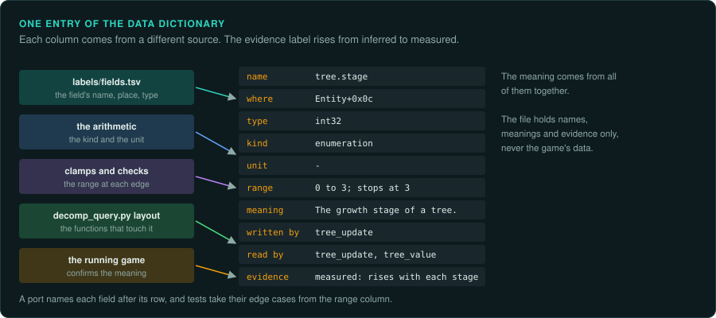

# The data dictionary



A project learns the meaning of hundreds of values: fields of structures, globals, fields of
files and saves, parts of network messages. `labels/names.tsv` names the functions and
`labels/fields.tsv` names the fields and their types. Neither says what a value means, in which
unit it is counted, which values it can take, or which code changes it. The data dictionary
holds that. It is one table, with one row for each value the rules use, and every row cites its
evidence.

The dictionary serves three readers. A person reading the findings learns what each value is.
An agent porting a system finds the unit and the range before it writes a type. A test author
finds the edge cases to check. When a save, a structure and a network message hold the same
value, the dictionary shows that they are one value with one meaning.

## Where it lives

Each project keeps its dictionary in `labels/dictionary.tsv`, beside the other label files.
`scripts/new-project.sh` creates it with the header row. It is a tab-separated text
file, so agents can search it, people can read it in an editor, and a change shows clearly in a
diff. Like the other label files, it holds names, meanings and evidence only, never the game's
data ([Legal](LEGAL.md)).

## The columns

| Column | What it holds | Example |
|---|---|---|
| `name` | A stable name for the value, written as `owner.field` | `tree.stage` |
| `where` | Where the value is stored, in one of the forms below | `Entity+0x0c` |
| `type` | The stored type and width | `int32` |
| `kind` | One of the [kinds of values](TAXONOMIES.md#kinds-of-values) | `enumeration` |
| `unit` | The unit of one step, or `-` | `-` |
| `range` | The values the game allows, and what happens at the edges | `0 to 3; stops at 3` |
| `meaning` | What the value is, in one plain sentence | `The growth stage of a tree.` |
| `written by` | The functions that change it | `tree_update` |
| `read by` | The functions that use it | `tree_update, tree_value` |
| `evidence` | The label and where it came from | `observed: tree_update adds 1 when age reaches 1` |

The forms of `where`:

| Form | Meaning |
|---|---|
| `Struct+0x0c` | A field at an offset in a structure named in `labels/fields.tsv` |
| `0x14002f000` | A global at an address in the binary |
| `file:records.dat+4` | A field in a data file, at an offset from the start of each record |
| `save:block3+0x10` | A field in a save file, in a named block |
| `msg:move+2` | A field in a network message or a replay command |
| `script:hero.hp` | A variable or a table field in the game's scripts |

When one value appears in several places, give it one row per place with the same `name`. The
rows together show how the value moves between memory, the save file and the network.

## An example

These rows describe the [sample game](../examples/sample-game/README.md) that GameFrame's tests
use. Each tree in the game is a small structure with a growth stage and the progress within that
stage.

| name | where | type | kind | unit | range | meaning |
|---|---|---|---|---|---|---|
| `tree.stage` | `Entity+0x0c` | `int32` | enumeration | - | 0 to 3; stops at 3 | The growth stage of a tree |
| `tree.age` | `Entity+0x08` | `float` | ratio | one stage | 0 up to 1, then 1 is taken off and the stage rises; grows past 1 at stage 3 | The progress within the current stage |
| `growth_table` | export `growth_table` | `float[4]` | ratio | stages per second | 0.05, 0.125, 0.3333333, 1.0 | How fast each stage grows |
| `rng.state` | `Random+0x00` | `uint32` | random state | - | any value | The state of the game's generator |
| `record.weight` | `file:records.dat+4` | `float` | ratio | - | as stored | The weight of one record in the data file |

The `written by`, `read by` and `evidence` columns are left out of this table to fit the page.
In the file, every row has them.

## How to fill it

1. **Start from `labels/fields.tsv`.** Every named field is a candidate row. Add the globals the
   rules use, and the fields of the data files and saves you have decoded
   ([re-format](../skills/re-format/SKILL.md)).
2. **Find the unit from the arithmetic.** A field added to a position every tick is a velocity in
   position units per tick. A field compared with 360, 256 or 65536 is probably an angle. A field
   that counts up once per tick is a time. Mark a unit found this way *inferred* until a
   measurement confirms it.
3. **Find the range from the checks.** Clamps, comparisons before a write, and the size of the
   table a value indexes give the range. Record what happens at each edge: a clamp, a wrap or a
   crash ([Integers on every platform](semantics/integers.md)).
4. **Find the writers and readers.** `tools/triage/decomp_query.py layout` lists every function
   that touches a field. Name the ones that write it and the ones that only read it.
5. **Confirm with the running game.** Watch the value in the original while you play
   ([Memory](observe/memory.md)). Change one thing in the game and see which values change
   ([Identifying unknown files](media/files.md#two-files-compared)). Then change the label to
   *measured*.

## Checking it

`tools/triage/dictionary.py` checks the file. It reports rows without ten columns, places
in an unknown form, kinds and evidence labels that are not in the [taxonomies](TAXONOMIES.md),
and the same name and place twice. With `--fields labels/fields.tsv` it also reports structure
fields that are missing from `fields.tsv` or have another type there, and counts the fields
that have no row yet. `--markdown` prints the rows as a table for a findings document.

```bash
python3 tools/triage/dictionary.py labels/dictionary.tsv --fields labels/fields.tsv
python3 tools/triage/dictionary.py labels/dictionary.tsv --markdown > docs/data.md
```

Run it before each commit that changes the dictionary. `--strict` turns warnings, such as an
empty unit, into errors.

## Using it

- **In the port.** Each field in the port's code carries the dictionary's name in its doc
  comment, so a search finds both. Its type comes from the `type` column, never from a guess.
- **In tests.** The `range` column lists the edges to test: the largest value, the wrap, the
  clamp.
- **In reviews.** A finding that adds a new value adds its row in the same commit.
- **For players and modders.** The dictionary is the start of a modding guide: which values exist,
  where they live, and what each one means.

## What to record

- One row for each value the game's rules read or write.
- The unit and the range of every row, or *unknown* with an entry under **Open questions**.
- Every place where the same value is stored, under one name.
