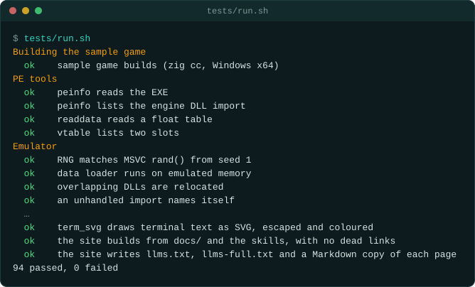

# Setup

To install and check everything:

```bash
scripts/setup.sh --install   # Ghidra, JDK 21, objdump, Node, Zig; .venv with unicorn, pefile, capstone, Frida
tests/run.sh --ghidra        # proves every tool against the sample game (~1½ min)
```

Then make the GameFrame home, the folder outside this clone that holds the games, the
projects, the machines and the shared Python:

```bash
./gameframe home init        # ~/gameframe, or $GAMEFRAME_HOME; writes config.env and python/
./gameframe home doctor      # checks the folders, config.env, each game and each project
```

The folders and the order settings are read in are in
[the GameFrame home](working/environments.md#the-gameframe-home).

`scripts/setup.sh` without options only checks and prints a table. The details (sizes,
Linux and Windows, REA registration for each agent, common problems) are in the `re-setup`
skill: [skills/re-setup/SKILL.md](../skills/re-setup/SKILL.md).

For Linux machines, containers and cloud agent workspaces, see
[Linux, cloud and container environments](working/environments.md). In each new shell or agent
session, `source scripts/env.sh` sets up the paths.

`./gameframe doctor` runs the same check. `./gameframe tools` then lists every tool with its
first line of help, and `./gameframe tool NAME` prints the rest.

Only GameFrame's MCP server is enabled by default. Opt a project into external providers with
`./gameframe mcp --enable rea`, `./gameframe mcp --enable dosbox`, or another provider from
`./gameframe mcp --list`. The command updates `.mcp.json`, refreshes configured clients, and updates
unchanged generated Copilot agent allowlists. `./gameframe mcp --disable NAME` removes one. Restart
the agent session after changing providers.

REA, DOSBox-X MCP, MCPEmulate and 86Box MCP each have a pinned version or source revision. Their
launchers read project-local overrides from the ignored `.env`, including paths to custom emulator
builds. The server setup commands and local setting names are in
[the MCP tool surface guide](working/mcp-toolchain.md). No external server is installed
automatically. `scripts/setup.sh --rea --client codex` remains REA's separate user-level setup
plan.



When the setup is complete, the run ends like this. Each check runs a tool against the sample game. The summary line
counts the checks that passed and failed. With `--ghidra` the run has more checks.

| Tool | Used for | Where it comes from |
|---|---|---|
| Ghidra 11 or 12 | Decompiling native code | https://ghidra-sre.org (Homebrew: `ghidra`) |
| JDK 21 | Running Ghidra | Homebrew `openjdk@21`, apt `openjdk-21-jdk`, or Adoptium |
| Python 3.10+ with unicorn, pefile, capstone | Emulation, PE reading, disassembly | `requirements.txt` into `.venv` |
| objdump (binutils or LLVM) | Reading instructions exactly | Homebrew `binutils`/`llvm`, apt `binutils`; Xcode's on macOS |
| Node.js 18+ | VitePress and other Node tools | https://nodejs.org |
| Node.js 22.23.4+, 24.22.1+, or 26.12.1+ | Optional REA MCP (`rea-agents` 6.8.0) | https://nodejs.org |
| Zig (optional) | Building the sample game for Windows from any host | https://ziglang.org |
| Frida (optional, about 40 MB) | Tracing calls in a running game (`tools/live/frida_trace.py`) | `requirements-live.txt` into `.venv` |
| REA (optional) | Evidence-backed inspection of binaries, packages, apps, runtimes; enable with `./gameframe mcp --enable rea` | https://github.com/morluto/rea |

Other tools that fit the method, for targets the toolkit does not cover itself: ILSpy or
dnSpyEx (.NET), Il2CppDumper or Cpp2IL (Unity IL2CPP), unluac (Lua bytecode), FModel and UE4SS
(Unreal), RenderDoc and apitrace (graphics frames), x64dbg (debugging, on your own copy only), binwalk (unknown archives), Wine or a Windows machine with Steam
Remote Play (running the original next to the reimplementation).
