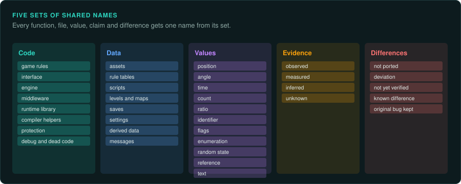

# Taxonomies

A project names many things: functions, files, fields, findings and the places where the port
differs from the original. When every agent and every person uses the same names for the same
kinds of thing, a search finds all of them, and a reader knows at once what a label means. This
page gives GameFrame's shared names for five sets of things. Use them in labels, in findings, in
the [data dictionary](DATA-DICTIONARY.md) and in commit messages.

The kinds of game have their own taxonomy in [A taxonomy of games](games/README.md).

## Kinds of code

Every function in a game's binaries belongs to one of these kinds. Label library and runtime
code first, so that tracing skips it ([Recognising an engine](engines/recognising.md#libraries-that-are-not-the-engine)).

| Kind | What it is | How to recognise it | Label prefix |
|---|---|---|---|
| Game rules | The behaviour the game is about: the simulation, the agents, combat, scoring | Uses the game's own structures and tables; called from the main loop | none, or the system's name |
| Interface | Menus, windows, the HUD, text and input handling | Draws text and sprites, reads input, calls the rules through commands | `ui_` |
| Engine | Drawing, sound, files, resources, the object system, an interpreter | Shared with other games of the engine; often named by a released source | `eng_` |
| Middleware | A licensed library for one job: video, sound, physics, compression | Its version string, its DLL or its constant tables ([Middleware](engines/middleware.md)) | the library, such as `bink_`, `zlib_` |
| Runtime library | The C runtime and the C++ standard library | Matches the compiler's library by signature | `crt_`, `std_` |
| Compiler helpers | Code the compiler added: 64-bit arithmetic, stack checks, exception tables | Short, called from everywhere, no game data | `__` names as the compiler gives them |
| Protection | Copy protection, packers, integrity and debugger checks | Runs before the game, or around it ([Packed and protected code](media/protection.md)) | `prot_` |
| Debug and dead code | Logging, consoles, test menus and code nothing calls | Format strings, assertions, no callers | `dbg_` |

## Kinds of data

Every file, block of memory and message holds one of these kinds of data. The kind decides what
the port does with it.

| Kind | Examples | What the port does |
|---|---|---|
| Assets | Pictures, models, sounds, music, fonts | Reads the player's own copy at run time ([What a project can ship](OUTPUTS.md)) |
| Rule tables | Unit and item statistics, prices, growth rates, AI weights | Reads them from the player's files, and never changes their values |
| Scripts | Bytecode, compiled scripts, trigger lists | Runs them with a ported interpreter ([Script interpreters](engines/interpreters.md)) |
| Levels and maps | Tile maps, sector maps, object placements, event scripts | Reads them, and keeps the order of every list in them |
| Saves | The world state written by the game | Reads and writes the original's format, if the project loads old saves |
| Settings | Configuration files, registry values, command-line switches | Reads them as inputs ([Inputs](observe/inputs.md)) |
| Derived data | Caches, compiled shaders, index files the game rebuilds | May rebuild them in its own way, if nothing visible depends on them |
| Messages | Network packets, replays, recordings | Uses the original's format where another program reads it |

## Kinds of values

A value's kind tells you its unit, its range and how it may change. Give every entry in the data
dictionary one of these kinds, written in lower case as in the first column.

| Kind | Typical form | What to record |
|---|---|---|
| Position | Integers in the game's units, fixed point, or floats | The unit (pixels, tiles, sub-pixels, metres), the origin and the axis directions |
| Angle | A byte or a 16-bit value for a full turn, degrees, or radians | Steps per full turn, the direction, and where zero points |
| Time | Ticks, frames, milliseconds, days of a calendar | The length of one unit, and what counts it (the timer, the main loop, the calendar) |
| Count | Integers for lives, ammunition, money or stock | The width, whether it is signed, and the largest value the game allows |
| Ratio | Fixed point or floats for a rate, a chance or a share, such as growth per tick | The scale (out of 1, 100, 256 or 65536), and the precision of each step |
| Identifier | An index into a table, a hash of a name, a handle with a generation | The table it indexes, or the hash function |
| Flags | Bits in a byte or a word | The meaning of each bit |
| Enumeration | A small integer from a fixed list | Every value and its meaning, often from a table of names |
| Random state | One or more words of a generator's state | The generator and every caller ([Library behaviour](semantics/libraries.md#random-numbers)) |
| Reference | A pointer, or an offset fixed up when a file loads | What it points to, and what replaces it in a save |
| Text | Bytes in an encoding, or an index into a string table | The encoding and the length limit ([Text and encodings](semantics/text.md)) |

## Kinds of evidence

Every claim carries one evidence label. [Writing findings](working/writing.md#evidence-labels)
gives the full rules.

| Label | Meaning |
|---|---|
| *observed* | Read in the code or the data |
| *measured* | Produced by running the original, with the inputs named |
| *inferred* | A reasoned guess, with what would confirm it |
| *unknown* | An open question |

## Kinds of difference

Every place where the port does not do what the original does is one of these kinds. The kind
goes in the code comment and in the deviations ledger, `docs/DEVIATIONS.md`, which
`tools/triage/deviations.py` writes from those comments.

| Kind | Meaning | Marked as |
|---|---|---|
| Not ported | A part of the original the port leaves out, such as a protection check or a dead debug menu | a comment containing `not ported` |
| Deviation | A change that the project chose, such as a larger screen or a fixed crash, with the reason | a comment containing `Deviation:` |
| Not yet verified | Code written from the evidence but not yet compared with the original | an open item in the project's checklist |
| Known difference | A difference found by a test and not yet fixed | a failing or skipped test, with an issue |
| Original bug kept | A bug in the original that the port copies, because players or saves depend on it | a comment that names the bug, with no deviation |

## Using the names

- Label prefixes go in `labels/names.tsv`, so that a search for `crt_` lists the whole runtime.
- The kinds of value go in the `kind` column of the [data dictionary](DATA-DICTIONARY.md).
- Findings use the evidence labels in every table.
- A commit that changes behaviour says which kind of difference it adds or removes.
