# Coroutines and state machines after compiling

Game logic often waits. A cut scene shows a line, waits two seconds, moves the camera and waits
for a key. Programmers write that as one function that pauses and continues later. The
compiler turns it into a class or a structure that holds a state number. A function then jumps
to the right place for that state. In the binary, or in the decompiled
code, the original function is gone, and a state machine is left in its place. This page
describes how each common form looks after compiling, and what a port must keep from it.

## C# iterators and Unity coroutines

A Unity coroutine is a C# iterator method, which returns `IEnumerator` and contains
`yield return`. The C# compiler turns each one into a nested class with a name such as
`<FadeOut>d__12`. The class has these fields and methods:

- `<>1__state`, an integer. It is 0 before the first call, and a higher number marks each place
  after a `yield return`. It is -1 while the method runs and after it ends.
- `<>2__current`, the value the last `yield return` gave.
- One field for each local variable of the method that lives across a `yield`, and one for
  `this`, named `<>4__this`.
- `MoveNext`, which switches on `<>1__state`, runs the code up to the next `yield`, stores the new
  state and returns `true`, or returns `false` at the end.

ILSpy and dnSpy turn these classes back into the original method. In an IL2CPP build the
class names and fields survive in the metadata, and Il2CppDumper lists them. The `MoveNext`
function in the native code is then a switch on a field at a fixed offset.

**When Unity resumes a coroutine.** What the coroutine yields decides when Unity calls
`MoveNext` again. `yield return null` resumes it in the next frame, after all `Update` calls and
before `LateUpdate`. `WaitForSeconds` uses scaled game time, so pausing the game with
`Time.timeScale = 0` stops it. `WaitForSecondsRealtime` does not stop. `WaitForFixedUpdate`
resumes it after the physics step. `WaitForEndOfFrame` resumes it after the frame is drawn. A
port must resume each coroutine at the same point of the frame, or the order of events
changes.

**C# `async` methods** compile in the same way, into a structure with a state field and a
`MoveNext`, driven by an `AsyncTaskMethodBuilder`. Unity games use them less often, and their
continuations can run on other threads.

## Lua coroutines

Lua coroutines are separate stacks inside the runtime, created with `coroutine.create` and
switched with `coroutine.resume` and `coroutine.yield`. Nothing is compiled into a state
machine. The paused state is the coroutine's stack and its position in the bytecode. To port a
Lua coroutine, port the script with an embedded Lua of the same version, or rewrite it with the
same points of waiting. Record the order in which the game resumes its coroutines each frame,
because the scripts do not show it.

## State machines written by hand

Older games written in C or assembly have no coroutines. Programmers wrote the state machines
themselves:

- **A state number and a switch.** An actor has a field holding its state, and the update
  function switches on it. Doom's actors use a table of states, each with a
  sprite, a duration, an action function and the next state ([The id Software
  engines](id-tech.md)).
- **A function pointer.** The actor holds a pointer to the function to call in the next frame.
  Each function sets the pointer to the next one. In the binary, a field is written with code
  addresses and then called through.
- **A position in a script.** The actor holds a pointer into a script, and the interpreter
  continues from there each frame ([Script interpreters](interpreters.md)).
- **Protothreads and Duff's device.** A macro trick that turns a C function into a state machine
  with a `switch` that jumps into the middle of loops. The decompiled code shows a `switch`
  whose cases land inside other statements.

In each form, the values the state field takes are the program's real structure. List them,
name them, and draw the transitions before porting.

## What a port must keep

- The states and the transitions between them, including the ones that look unreachable.
- When each state machine advances in the frame, such as before or after the others, before or after
  physics, before or after drawing.
- How long each wait lasts, in frames or in game time, and whether pausing the game stops it.
- What happens when the owner of a coroutine or a state machine is destroyed while it waits.
  In Unity, destroying a `MonoBehaviour` stops its coroutines. Deactivating its GameObject
  stops them too. Setting `enabled = false` on the component does not stop them.

## What to record

- Each coroutine or state machine the rules use, with its states and transitions.
- What each one waits for, and the point in the frame where it resumes.
- The order in which several waiting coroutines resume in one frame, measured in the original.
