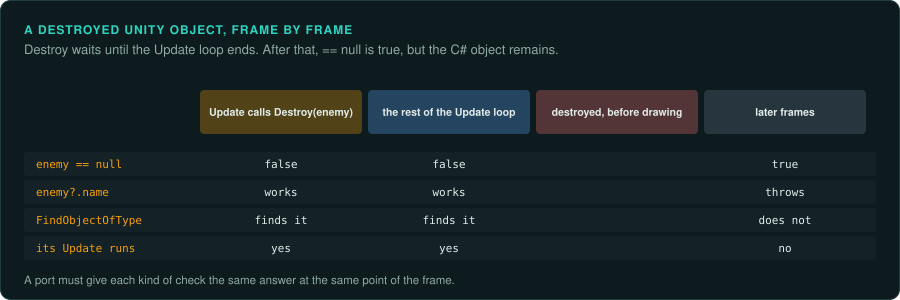

# Garbage collection the player can see

Games written in C#, Lua, ActionScript, Java or Python do not free their objects themselves. A
garbage collector frees them when nothing refers to them any more. Most of the time this is
invisible, and a port can manage memory in its own way. Sometimes the collector's timing reaches
the game. A sound stops, a cache empties, an object that was destroyed still answers, or a
frame takes longer. This page lists those cases for the runtimes games used, and what a port
must do about each.

## When collection shows

- **Finalisers and `__gc`.** Code that runs when the collector frees an object. If it stops a
  sound, releases a resource or writes a log, the player may notice when it runs. The timing
  depends on memory use. The game's own clock does not decide it.
- **Weak references.** A weak table, a weak dictionary or a weak event listener lets the
  collector remove an entry. A cache built on one empties at the collector's moments, and the
  game then loads or computes the entry again.
- **Pauses.** A full collection can take several milliseconds. Players see it as a stutter. It
  changes nothing in a game with a fixed step, but a game whose step takes the measured frame
  time moves further in that frame.
- **Destroyed objects that still exist.** Engines with their own object lifetime on top of the
  collector, such as Unity, keep the managed object after the engine has destroyed it.

## Runtime by runtime

| Runtime | Collector | What shows |
|---|---|---|
| Unity with Mono | Boehm-Demers-Weiser, conservative and non-moving; incremental in later versions | Finalisers run on their own thread in no fixed order. Destroyed engine objects compare equal to `null` while the C# object still exists |
| .NET | Generational and moving | Finalisers run on a finaliser thread, in no fixed order, after a collection finds the object |
| Lua 5.1 and later | Incremental mark and sweep; Lua 5.4 also has a generational mode | `__gc` metamethods on userdata (5.1) and on tables (5.2 and later) run in the reverse order of their marking. Weak tables (`__mode`) lose entries at each cycle |
| Flash Player | Mark and sweep, started by allocation | `Dictionary` with weak keys and weak event listeners lose entries; `System.gc()` was only available in the debug player |
| CPython | Reference counting, plus a cycle collector | Most objects are freed at once, when the last reference goes. Objects in cycles wait for the cycle collector |

## Unity's destroyed objects

`Object.Destroy` does not destroy at once. Unity destroys the object after the current `Update`
loop, before drawing. Until then, the object still runs and can still be found. After that,
the C# object remains while anything refers to it, but Unity's `==` operator reports it as
equal to `null`. The `?.` and `??` operators do not use that operator, so they still see the
object, and a call on it then throws a `MissingReferenceException`. Game code written against this behaviour, with `if (target == null)` checks, works
because of it.

A port in another engine or language must give the same answers at the same moments:

1. Mark an object as destroyed when the original calls `Destroy`.
2. Keep it in place until the point in the frame where Unity would remove it.
3. Make every check that the original did with `==` report a removed object as missing, and
   every `?.` or `??` check report it as present.

`DestroyImmediate` destroys at once. Find which one each call in the original uses.

## What a port should do

- **Keep the port independent of its own collector.** No port should depend on when its collector runs. Make
  every effect that the original tied to collection happen at a fixed, chosen point instead.
- **Find what the original did in practice.** Run the original, and log when each finaliser
  or weak entry clearance happened. If it happened at the same point every time, give the port
  that point. If it varied, record that the original was not deterministic here, and choose one
  behaviour for the port.
- **Keep the order of finalisers** where it shows, such as sounds that stop in a given order.
  Lua documents its order. Mono and .NET do not, so measure it.

## What to record

- The runtime, its version and its collector.
- Every finaliser, `__gc` metamethod, weak table and weak listener that the rules or the sound
  depend on, and when they run in the original.
- In Unity games, every use of `Destroy` and `DestroyImmediate` on objects the rules use, and
  every null check that depends on Unity's `==`.
