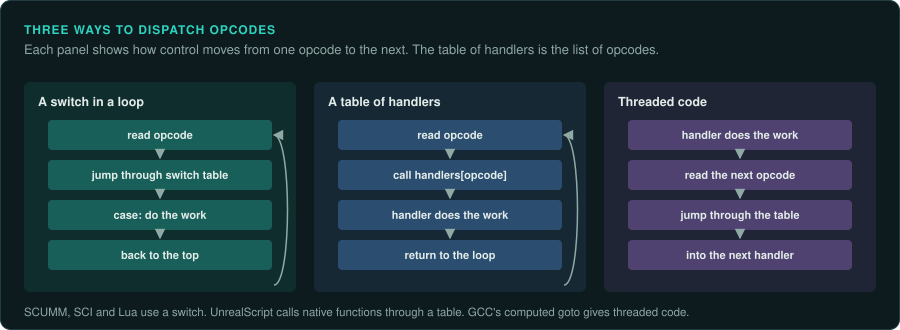

# Script interpreters in machine code

Many games run part of their logic in an interpreter. Adventure games run room scripts. RPGs
run dialogue and quest scripts. Strategy games run mission triggers. Engines such as Quake and
Unreal run their game code as bytecode. When the interpreter is ported, the port runs the
game's own scripts unchanged. This page describes how to find an interpreter in machine code,
how to read its design, and what a port must keep. The family pages describe particular
interpreters: [Adventure and story games](../games/adventure.md), [The id Software
engines](id-tech.md), [Unreal Engine 1 and 2](unreal.md), [Studio engines](studio-2d.md).

## Finding the interpreter

The interpreter is a loop that reads a code from the script, picks a piece of code for it, runs
that piece, and goes round again. In the binary it usually has these signs:

- A pointer into a block of script data that is read one byte or one word at a time and moved
  forward after each read.
- A jump through a table indexed by the byte just read, or a long `switch` that the compiler
  turned into such a table.
- Dozens or hundreds of small functions or blocks that each end by returning to the loop, or by
  jumping to the next code.
- Strings with opcode names, error messages such as "bad opcode" or "stack overflow", or a
  disassembler left in the build for debugging.

Follow the references to the script files from the code that loads them. The function that
receives the loaded data and keeps a pointer into it is the interpreter or its caller.

## Dispatch

| Style | In machine code | Where |
|---|---|---|
| A switch in a loop | One loop; a bounds check and a jump through a table to each case; each case jumps back to the top | Most C interpreters: SCUMM, SCI, Infinity Engine scripts, Lua |
| A table of handlers | A loop that calls `handlers[opcode](state)` through a table of function pointers | Many C++ engines, and the native functions of UnrealScript (`GNatives`) |
| Threaded code | No central loop; each handler ends by reading the next opcode and jumping through the table itself | Interpreters built with GCC's computed `goto`, and Forth-like systems |
| Translated ahead of time | The script becomes native code when it loads or when the game is built | Quake III's QVM compiler, IL2CPP for Unity, JIT compilers |

The table of handlers is the list of opcodes. Label each entry with its number before reading
any handler. Then decode one script by hand with that list, and write a disassembler for the
format ([re-format](../../skills/re-format/SKILL.md)). A disassembler that reads every
byte of every script file proves that the list of opcodes and their operand sizes is complete.

## Stack machines and register machines

- **Stack machines** push operands, then an operation pops them and pushes its result. The JVM,
  CPython, Flash's AVM1 and AVM2, UnrealScript and most adventure engines work this way. Their
  opcodes are short, and many take no operand.
- **Register machines** name their operands as numbered slots in each instruction. Lua 5.0 and
  later, and Dalvik, work this way. QuakeC's virtual machine is close to it. Each instruction
  names up to three addresses in the global data.

The kind of machine shows in the handlers. A stack machine's handlers move a stack pointer. A
register machine's handlers decode operand fields from the instruction word with shifts and
masks.

## What a port must keep

- **Every opcode and its exact effect**, including the ones the shipped scripts never use, if the
  project wants mods and fan scripts to work.
- **Integer widths and overflow** in the interpreter's arithmetic. A 16-bit variable in an
  adventure engine wraps at 16 bits ([Integers on every platform](../semantics/integers.md)).
- **Time.** How a script waits, whether for a number of frames, for an animation to end or for input. Some
  interpreters run a fixed number of instructions per frame, and then the number itself is part
  of the timing.
- **The order of scripts.** When several scripts run in one frame (one per actor, one per room),
  the order in which the interpreter runs them, and whether a script that starts another one
  runs it at once or in the next frame.
- **Bugs the scripts rely on.** Uninitialised variables, reads past the end of an array, and
  opcodes that do slightly the wrong thing. Shipped scripts may depend on them. Keep each one,
  and mark it in the code.
- **Versions.** Engines change their opcodes between games, and sometimes between versions of
  one game. Record the version for each game, and give the port a table per version.

## Testing an interpreter port

1. Disassemble every script with your disassembler. Every byte must be read.
2. Run single scripts in the original and in the port with the same variables, and compare the
   variables after each instruction. An instruction trace from the original's interpreter, made
   with a breakpoint on the dispatch, gives the reference.
3. Play through the whole game with a known solution in both, and compare the variables after
   each command.

## What to record

- The address of the dispatch loop and of the handler table.
- The list of opcodes with their operands and effects, per engine version.
- How scripts wait and in what order they run each frame.
- Every bug in the interpreter that the shipped scripts depend on.
