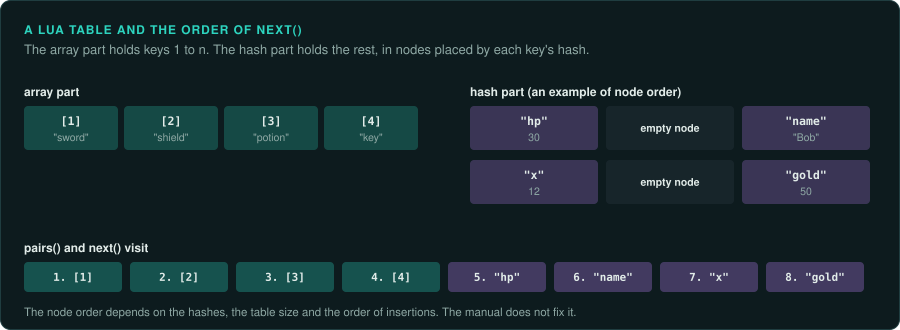

# Objects in script runtimes

Many games keep their rules in a script language: Lua, ActionScript, UnrealScript, Python,
JavaScript or C# in Unity. Each language has a runtime that stores the script's objects in its
own way. Two things about that storage matter to a reimplementation. The first is where a field
of an object sits in memory, which you need when you read a value from a running game. The second
is the order in which the runtime visits an object's fields or a table's entries, because game
logic that loops over a table depends on it.

This page describes both for the runtimes games used. The facts come from each runtime's
documentation and source. [Engine structures](engine-structures.md) covers objects in compiled
C++ engines, and [Memory](../observe/memory.md) covers finding a value in a running game.

## How each runtime stores an object

| Runtime | An object is | A named field is found by |
|---|---|---|
| Lua 5.x | A table with an array part (keys 1 to n) and a hash part | Hashing the key and following a chain inside the hash part |
| Flash AVM2 (ActionScript 3) | An object of a sealed class has fixed slots, one per declared variable; a dynamic object also has a hash table | A slot number for declared variables; a hash lookup for dynamic ones |
| UnrealScript | An object of a class whose properties sit at fixed offsets, set when the class is compiled | The offset, which the class's property list in the package gives |
| CPython | An object with a dictionary of attributes, or fixed slots when the class declares `__slots__` | Hashing the name in the dictionary |
| JavaScript (V8, SpiderMonkey) | An object with a hidden class (a shape) that maps names to slots, plus the slots | The shape, then the slot; the runtime caches the slot at each place in the code |
| Mono and .NET (Unity) | An object header with a pointer to its class, then the fields at offsets fixed by the class | The offset, from the class's metadata |

**Shapes.** JavaScript engines give objects with the same fields, added in the same order, the
same hidden class. The class records the slot of each field. Adding a field moves the object to
another hidden class. Two objects with the same fields added in a different order have
different hidden classes. In a heap snapshot from the browser's tools, each object lists its
fields by name, so you can find a value without knowing the slots.

**Fixed layouts.** UnrealScript, Mono and sealed ActionScript classes put each field at a fixed
place. Read the place from the class definition, which is the package's property list, the .NET metadata
(with ILSpy or dnSpy), or the ABC file's traits (with JPEXS). Then a memory dump can be read like
a C structure.

**Hash tables.** Lua tables, Python dictionaries and dynamic ActionScript objects store fields
by hashing the name. A field's place depends on the hash of its key, the size of the table and
the keys inserted before it. To read such a field from a dump, walk the table as the runtime
does, or ask the running game through a debugger or a console.

## The order of iteration

A loop over all of an object's fields, or all of a table's entries, visits them in an order the
runtime chooses. If the loop does something visible for each entry, such as spawning a unit,
drawing a random number or printing a line, that order is part of the game's behaviour.

| Runtime | Order of a loop over entries |
|---|---|
| Lua `pairs` and `next` | The array part in order, then the hash part in the order of its internal nodes. The node order depends on the hash of each key, the table's size and the history of insertions. The manual leaves it unspecified |
| Python dicts, 3.7 and later | Insertion order, guaranteed by the language |
| Python dicts before 3.6 | Hash order, which changes with the table's size. String hashes are randomised per run from Python 3.3, unless `PYTHONHASHSEED` is set |
| JavaScript objects | Integer-like keys in ascending order, then other string keys in insertion order |
| ActionScript 3 `for..in` on dynamic properties | Not specified; it follows the player's hash table |
| .NET `Dictionary` | Insertion order while nothing is removed; a removal leaves a gap that the next insertion fills. The order is not part of the documented contract |
| .NET `HashSet`, `Hashtable` | Hash order |

**Port the order of the entries as well as their contents.** If a Lua loop over a table spawns enemies, the port
must spawn them in the same order. There are two ways to do that. Port the runtime's table
exactly, with its hash function, its sizes and its collision handling. Or record the order the
original used for each table in each situation, and show that it never changes. The first way
is more work, but it holds for every input. A reimplementation of the runtime itself, such as a
port that embeds the same Lua version, gets the order for free.

**Watch for orders that change from run to run.** Python's string hash randomisation, tables
keyed by object addresses, and hash orders that depend on memory layout can make the original
itself behave differently on each run. Record that as a finding. The port can then choose one
order, and the deviations ledger says which.

## Reading the scripts

Before porting a runtime, decompile the scripts. The bytecode keeps names, and the names show
what each table holds.

| Language | Decompiler |
|---|---|
| Lua 5.0 to 5.4 | unluac, luadec; LuaJIT has its own bytecode and tools |
| ActionScript 1, 2 and 3 | JPEXS Free Flash Decompiler ([Flash and Shockwave games](flash-and-shockwave.md)) |
| UnrealScript | UE Explorer, and the tools in [Unreal Engine 1 and 2](unreal.md) |
| Python bytecode | decompyle3, uncompyle6, pycdc; each covers some Python versions |
| C# in Unity | ILSpy, dnSpy; for IL2CPP builds, Il2CppDumper first ([Engine-era PC games](../computers/modern-pc-engines.md)) |

## What to record

- The runtime and its exact version.
- For each table or object type the rules loop over, the order of the loop and how the port
  reproduces it.
- Any order that changes between runs of the original.
