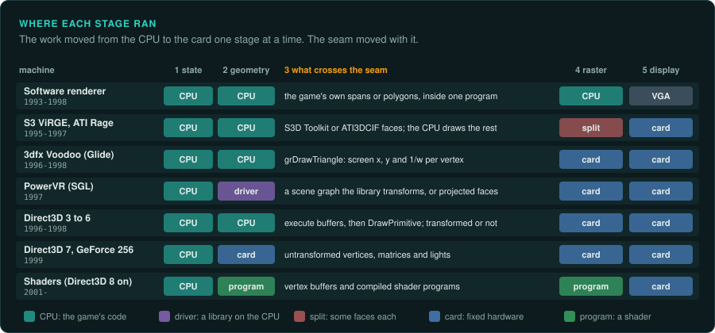
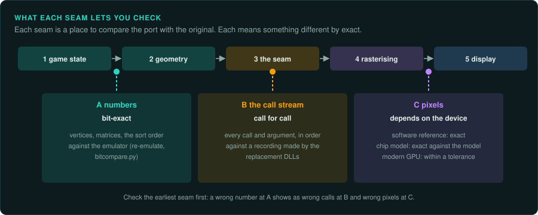
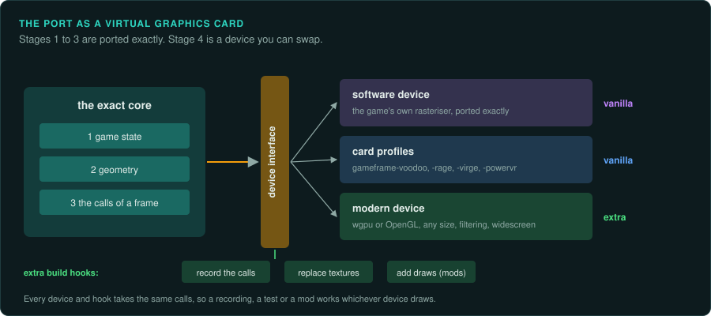

# The rendering pipeline

A game draws each frame in stages. Some stages ran on the CPU and some on a graphics card, and
the split changed from year to year. This page names the stages and shows where each one ran
on each machine. It says what a port can check at each step between stages. Then it shows how
to build a port with the same shape, so one game can draw like its software renderer, like
each card it supported, or better than any of them.

Try it in your browser first. [Rendering pipeline](https://tanepiper.github.io/game-frame/lab/pipeline) on the site takes one frame
through every stage and draws it with three devices side by side.

## The five stages



| Stage | What happens | What it hands on | Where the code is |
|---|---|---|---|
| 1. Game state | The game moves things, places the camera and decides what is visible | Objects, a camera, a list to draw | The game's own code |
| 2. Geometry | Transform to the camera, light, project to the screen, clip, sort | Screen-space vertices with `1/w` and texture coordinates | The game's own code until 1999 |
| 3. The seam | The game hands the frame over | Calls: states, texture uploads, triangles, a swap | The calls into a renderer or a card's library |
| 4. Rasterising | Triangles become pixels: texture, blend, fog, depth test, dither | Pixels in a frame buffer | The game's software renderer, or the card |
| 5. Display | The frame buffer becomes a picture | A palette or 16-bit colour, gamma, a page flip | The video card |

Stage 3 is different from the others. Nothing is computed there. It is the place where one part
of the program stops and another starts, so it is the most useful place to cut the game in two.

## Where each stage ran



The work moved from the CPU to the card one stage at a time:

- **Software renderers (to about 1998)** did every stage on the CPU. The game drew spans of
  pixels into a frame buffer in memory, and the VGA card only showed it. The same input gives
  the same pixels on every machine, so a software renderer is the easiest reference to compare
  ([Pixel-exact software rendering](software-rendering.md)).
- **The first 3D cards (1995 to 1998)** took stage 4 only. Glide's `grDrawTriangle` takes
  vertices already projected to the screen, with `1/w` for perspective
  ([3D accelerators](graphics-3d.md)). The game still did the 3D maths in its own code.
- **Hardware transform and lighting** came with the GeForce 256 and Direct3D 7 in 1999. The
  game now handed over untransformed vertices with matrices and lights, and stage 2 moved to
  the card.
- **Shaders** (Direct3D 8 on, 2001) made stages 2 and 4 programs the game ships
  ([Shaders](shaders.md)).

Two machines do not fit the simple picture:

- **The S3 ViRGE and the ATI Rage** drew textured triangles, but slowly. Builds of the time
  often gave them only some faces, untextured or blended, and drew the rest with the CPU.
  Stage 4 was split between the two ([The card makers' 3D APIs](card-apis.md), "One game, one
  build per card").
- **The PowerVR with SGL** has its seam higher up. In SGL's scene-graph mode the game builds a
  scene of transforms, meshes and lights, and SGL's library does stage 2 on the CPU. A port of
  that build must do what the library did. SGL's immediate mode (`sgltri_*`) takes projected
  faces like Glide ([sgl](../../wrappers/sgl/README.md)).

### Software and card in one game

Many games shipped a software renderer and one or more card renderers. Quake had a software
build, and GLQuake drew through OpenGL on the same game code. Tomb Raider (1996) got a patch
for 3dfx cards. POD shipped one executable per card ([POD case study](../case-studies/pod.md)).
Glide itself never drew in software. Each renderer was its own code in the game, and the
game chose between them in its options or by which program you started.

The renderers share stages 1 and 2 almost always. They differ after the seam. That is why the
seam is where a port should cut.

### A frame the card and the CPU draw together



A card did not always draw the whole frame. Glide lets a game lock the frame buffer
(`grLfbLock`) and write pixels into it with the CPU. Games used it for the interface, the
text, a video or a loading screen, drawn over the 3D the card had drawn. In that frame stage 4
ran in two places. Port each part from its own code: the card calls, and the CPU's pixel
writes, in the order the game made them.

## Find the seam in a game

1. **List the renderers.** Look for one DLL per renderer (`GlideDrv.dll`, `SoftDrv.dll`), one
   executable per card, or a choice in the options. `tools/pe/peinfo.py --imports` shows which
   card libraries each program imports.
2. **Find the interface.** In a game with renderer DLLs it is their exports or a C++ class with
   virtual methods. In a game with one executable per card, match the builds with
   `tools/triage/match_functions.py`. The functions that differ between builds sit after the
   seam, and the ones that match sit before it.
3. **Read what crosses it.** Write down each call, its arguments and their meaning: the vertex
   layout, the state values, the texture formats ([The card makers' 3D APIs](card-apis.md),
   "Read the state calls").
4. **Check the split.** For each build, list what it hands to the chip and what it still draws
   with the CPU. A build called "accelerated" sometimes accelerates very little.

## What each seam lets you check



Each seam is a place to compare the port with the original. Each one means something
different by "exact".

| Seam | What you compare | How exact | How |
|---|---|---|---|
| A, after stage 2 | Vertices, matrices, the sort order | Bit for bit | Run the original's functions under the emulator and compare ([re-emulate](../../skills/re-emulate/SKILL.md), `tools/verify/bitcompare.py`) |
| B, at the seam | Every call and argument, in order | Call for call | Record the calls the original makes and the calls the port makes, then compare the two lists (`tools/verify/seqdiff.py`) |
| C, after stage 4 | Pixels | Depends on the device | Capture frames from the original and the port ([Capturing what the game draws](../observe/drawing.md)) |

At seam C "exact" depends on what drew the reference:

- **A software renderer** gives exact pixels on any machine. Compare them exactly.
- **A card** gives exact pixels only against a model of that chip. `gameframe-voodoo` models
  the Voodoo from 3dfx's register specification, so a port can match it pixel for pixel
  ([crates](../crates/README.md)). The real card may still differ where the specification
  is silent.
- **A modern GPU** rounds and filters in its own way. Compare with a tolerance and look at the
  difference image.

Check the earliest seam first. A wrong number at A shows as wrong calls at B and wrong pixels
at C, and it is easiest to find at A.

To record the call stream of the original:

- For OpenGL and Direct3D, apitrace records every call ([Capturing what the game draws](../observe/drawing.md)).
- For a card library, `tools/live/frida_trace.py --hook glide2x.dll!_grDrawTriangle@12=tri`
  logs each call while the game runs. Its `--args` option adds the arguments. For Glide those
  are pointers to the vertices, so log the values from a stand-in library when you need them.
- GameFrame's [replacement libraries](wrappers.md) receive every call the game makes. They are
  the natural place to write the stream to a file.

## The port as a virtual graphics card



Build the port with the same shape as the machine. Cut it at the seam:

- **The exact core** runs stages 1 to 3. It is ported from the original's code and cites it
  ([re-port](../../skills/re-port/SKILL.md)). It ends in calls to one **device interface**.
- **The device interface** carries what crossed the original's seam: the states, the texture
  uploads, the triangles, the frame-buffer locks and the swap. It carries nothing from the game
  state, so a device cannot change the game.
- **Devices** sit behind it. Each one draws the same calls in its own way.

| Device | Draws | Use |
|---|---|---|
| Software | The game's own rasteriser, ported exactly | The reference when the game had a software renderer |
| Card profiles | The chip crates: `gameframe-voodoo`, `gameframe-rage`, `gameframe-virge`, `gameframe-powervr` | What each card showed the player, and the reference for card-only games |
| Modern | wgpu or OpenGL at any size, with filtering and widescreen | Better pictures |

A sketch of the interface in Rust. Name its calls after the original's seam, so a reader can
match them:

```rust
/// What crosses the seam in one frame. The exact core calls it; a device draws it.
pub trait Device {
    fn set_state(&mut self, state: &RenderState);
    fn upload_texture(&mut self, id: TextureId, format: TexelFormat, texels: &[u8]);
    fn draw_triangles(&mut self, vertices: &[ScreenVertex]);   // x, y, 1/w, s/w, t/w, colour
    fn lock_frame_buffer(&mut self) -> FrameBufferWrite<'_>;   // the CPU's own pixels
    fn swap(&mut self);
}
```

Keep these rules:

- **The core never asks the device how it drew.** A game that read pixels back (Glide's
  `grLfbReadRegion`) is the exception. Record each read back as an input of the core, so a
  replay gives the same frame.
- **Every device takes every call.** A device that cannot draw a state says so in its log, and
  the frame still completes.
- **The software device follows the original's arithmetic.** It is ported like the rest of the
  core, with its own parity tests.

### Vanilla and extra builds

The same cut makes the two builds of [installing a build](../working/building-the-port.md)
simple:

- The **vanilla** build ships the exact core with the reference device and the card profiles.
  It draws what the original drew.
- The **extra** build adds the modern device and hooks at the interface: record the calls,
  replace textures, add draws for a mod, capture frames. A hook sees each call before the
  device does.

The core is the same in both builds. A recording made with one build replays in the other,
and a test of the core passes in both.

## What to record in the project

Write these in the project's `AGENTS.md` or `docs/`:

- the renderers the game shipped, and the seam each one used;
- the reference device, and why it was chosen;
- for each card build, what it handed to the chip and what it drew with the CPU;
- each difference between a device and its original, marked as a deviation.

## Sources

- 3dfx Interactive, *Glide 2.2 Programming Guide* and *Glide 2.x Reference Manual*: the calls
  named here (`grDrawTriangle`, `grLfbLock`, `grBufferSwap`) and the vertex layout.
- 3dfx Interactive, *SST-1 Graphics Engine for 3D Game Acceleration*, revision 1.61: the
  Voodoo's pixel pipeline, which `gameframe-voodoo` follows.
- id Software, Quake source release, `WinQuake/d_draw16.s`: its header comment says the 8-bit
  span drawer uses 16-pixel subdivision. That is the perspective step every 16 pixels that the
  lab page shows.
- NVIDIA, GeForce 256 (1999): the first PC card with hardware transform and lighting, exposed
  through Direct3D 7 ([3D accelerators](graphics-3d.md)).
