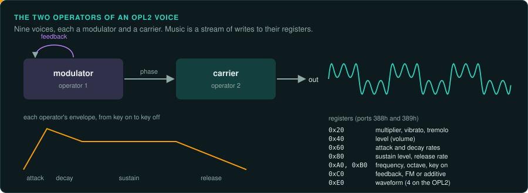
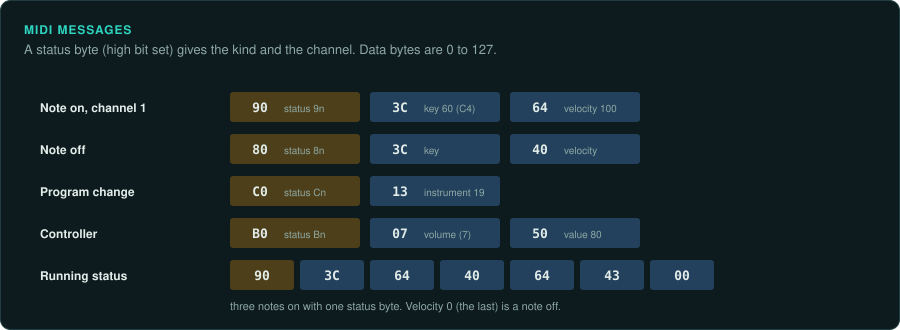

# Sound

Sound hardware in DOS games is programmed directly. A game's music may exist only as commands to a synthesiser chip. Its timing may come from the sound card's interrupts. To reproduce
the sound exactly, you need to know which device the game wrote for and how it drove it.

## The devices

| Device | Year | How games use it | Notes |
|---|---|---|---|
| PC speaker | 1981 | Tones from timer channel 2 (port `42h`), switched on through port `61h` | Some games played samples by switching the speaker very fast |
| IBM PCjr and Tandy 1000 | 1984 | TI SN76496 tone/noise registers; some Tandy models use NCR 8496 or PSSJ audio | Common in early DOS games and ports; later PSSJ adds an 8-bit DAC |
| Covox Speech Thing and Disney Sound Source | 1987 | 8-bit samples written through an LPT port | The Disney device adds a FIFO; both can be driven by software timing |
| Creative Music System / Game Blaster | 1987 | Two Philips SAA1099 chips | Square-wave voices, noise and stereo |
| AdLib | 1987 | The Yamaha YM3812 (OPL2) FM chip at ports `388h` and `389h` | 9 voices of FM synthesis; music is a stream of register writes |
| Roland MT-32 | 1987 | MIDI through an MPU-401 interface (port `330h`) | Its own synthesis and sounds; many Sierra games were written for it |
| Sound Blaster | 1989 | An OPL2 for music, and an 8-bit digital channel (the DSP) with DMA | Settings in the `BLASTER` environment variable: port, IRQ, DMA |
| Sound Blaster Pro | 1991 | SB Pro 1 uses two OPL2 chips; SB Pro 2 uses the YMF262 OPL3 | Both provide stereo PCM |
| Sound Blaster 16 and AdLib Gold | 1992 | SB16 adds 16-bit DMA; AdLib Gold adds stereo and a digital section | OPL3 implementations vary across card revisions |
| Pro AudioSpectrum, Windows Sound System and ESS AudioDrive | 1991 onward | 16-bit PCM through a codec; models vary in OPL3, Sound Blaster compatibility and mixer support | Identify the exact card and codec |
| Gravis Ultrasound | 1992 | 32 hardware voices playing samples from the card's own memory | Popular with tracker music and the demo scene |
| General MIDI modules (Roland SC-55) | 1991 | MIDI through an MPU-401 | General MIDI fixed the instrument numbers |
| AWE32/AWE64 | 1994 | Sound Blaster PCM plus EMU8000 wavetable voices and uploaded banks | Games may use the SoundFont Manager as well as `midiOut` |
| Aureal A3D and Creative EAX | 1997–1998 | DirectSound 3D extensions for positional audio and environmental effects | APIs differ: A3D exposes COM interfaces; EAX uses DirectSound property sets |

## Creative Music System and Game Blaster

The CMS/Game Blaster uses two Philips SAA1099 chips. Each chip provides six square-wave channels,
two noise generators, two envelope controllers and stereo amplitude registers. The
[`gameframe-saa1099` crate](../../crates/saa1099/README.md) models the chip registers and the
four-port card window. Its port map and default address come from static traces of `CMSDRV.COM` and
Sierra's `CMS35.BIN`; register timing follows Philips's data handbook and its SAA1099 article. The
model includes the common CMS detection-port response reported by a compatible-card manual. The
noise seed, combined tone/noise gate, full custom-chip behavior, bus waits and analog output still
have software-only follow-up checks. See the [CMS/SAA1099 evidence and check plan](cms-saa1099.md).

## PCjr and Tandy 1000 PSG

The IBM PCjr and original Tandy 1000 use the TI SN76496 for three tone channels and one noise
channel. The [`gameframe-sn76496` crate](../../crates/sn76496/README.md) models the serial register
protocol, input-clock advancement, sample generation and the PCjr four-source output mux selected
by port `61h` bits 5–6. The Tandy adapter maps writes at `C0h`–`C7h`, routes PIT channel 2 to
the chip's AUDIO IN pin and exposes the service manual's approximate 42 CPU wait states. Static
traces of Sierra's original `JR.DRV` and `TANDY.DRV` confirm tone latch/data writes, attenuation
writes, startup mutes and PSG-output selection. Tandy has a separate output mux whose full source
table remains open. Tandy 1000 HX documentation identifies an NCR 8496, while later PSSJ machines
add an 8-bit DAC. Those variants, noise feedback details, period-zero behavior and analog output
still need software-only comparisons. See the [Tandy PSG findings and check plan](tandy-psg.md).

## FM synthesis (OPL2 and OPL3)

Music for AdLib and Sound Blaster is a stream of writes to the chip's registers: which voice,
which frequency, which instrument settings, key on and key off. The chip turns these into sound.

- **Capture the register writes**, with the time of each, from the original running in an
  emulator. This is exact ground truth for the music code, independent of the chip.
- **Port the music driver** so it produces the same writes at the same times. Compare the two
  lists write by write.
- **Emulate the chip** in the port to turn writes into samples. `gameframe-opl2` covers the
  YM3812, including CSM speech mode and its timer-triggered key pulses. `gameframe-opl3` models
  both YMF262 register banks, two- and four-operator voices, four sample outputs, OPL2
  compatibility mode, shared note selection, timers and indexed ports. Its status signature
  stays distinct from the YM3812 in compatibility mode, and it omits the YM3812's CSM feature.
  The original AdLib Gold `GSSOPL3.DRV` binary documents its banked writes, busy polling, second
  data-port reads and setup of registers `0x104` and `0x105` ([trace](adlib-gold-gssopl3.md)). The
  Ad Lib Gold Developer Toolkit identifies the second-bank `0xFF`/`0xFE` switches as Control Chip
  access and documents its status and registers. `gameframe-adlib-gold` models that port overlay
  and register interface around `gameframe-opl3`. The chip model follows Yamaha's datasheet
  through its serial DAC interface. `gameframe-yac512` models the external DAC's serial input,
  FSEL decoding and sample latches. `gameframe-ymz263` models the AdLib Gold's digital PCM/ADPCM
  channels, FIFOs, timers, DMA request state and MIDI UART. The card routes the MMA ports and
  sampling interrupt. YMZ263 ADPCM rounding, interleave and some status details still need a
  software comparison. Independent carrier routing in four-operator mode, output parity, YAC512's
  floating analog transfer, AdLib Gold analog mixer/filter behavior and analog input paths remain
  open.
- The driver's tempo usually comes from a timer interrupt the game programmed. Find the
  interrupt rate and the driver's tick counter. Small errors in the rate change the music's
  speed over a song.

## Digital sound (Sound Blaster DSP)

The game sets up a DMA transfer from a buffer to the card and tells the card's DSP the sample
rate. When the buffer has played, the card raises an interrupt. The game then refills
the buffer.

- Sample rates are set as a "time constant": `256 - 1,000,000 / rate`. The real rate is the
  rate that constant gives, which is not exactly the rate the game asked for. Compute it.
- Games mix several effects into one buffer in software. If the sound must match, port
  the mixer's volume scaling and clipping exactly.
  Games of 1997 to 1999 often had a second, MMX mixer that scales with `pmulhw` and clips
  with `paddsw`, and its samples can differ from the plain build's ([SIMD code](simd.md)).
- If the game counts sound interrupts to time anything, that count is an input.

## MIDI

MIDI music is a list of note and controller events, often stored in a game's own format or as
standard MIDI files. The sound depends entirely on the synthesiser. The same music sounds very
different on an MT-32, a Sound Canvas and a Sound Blaster's FM.

- Port the MIDI player: the events and their timing must be exact.
- Play the events through a software synthesiser with sounds of the reference device (an
  MT-32 emulator such as Munt, or General MIDI sound fonts).
- MT-32 games often upload their own instrument settings to the device at start-up with SysEx
  messages. Capture and replay them.

## Sound drivers in DOS games

Many games used a sound library instead of programming cards themselves: the Miles Audio
Interface Library, DIGPAK and MIDPAK, the HMI Sound Operating System. Each loads a driver for
the player's card. Label the library and port what the game asks of it: play this sample,
play this song, set this volume ([Middleware](../engines/middleware.md)).

## Windows sound

| API | Year | Notes |
|---|---|---|
| WinMM (`waveOut`, `midiOut`) | 1991 | Simple and with high latency |
| DirectSound | 1995 | Mixing by the system or the card; 3D sound from DirectX 3 |
| DirectMusic | 1999 | Music with styles and segments that change with the game |
| A3D (Aureal) | 1997 | Positional 3D sound in hardware |
| EAX (Creative) | 1998 | Reverb and environment effects on top of DirectSound 3D |

A3D and EAX effects need hardware that no longer exists. Software reimplementations exist
(OpenAL Soft supports EAX effects). Decide whether the port reproduces them and record it.
[The sound card makers' APIs](sound-card-apis.md) covers these and the other card libraries
of the time, and the stand-ins in `wrappers/`.
[PC audio coverage](audio-coverage.md) tracks which devices and APIs GameFrame can reuse today
and which reusable pieces remain to build.

## Checklist

1. Find which devices the game supports, from the setup program and the drivers it ships.
2. Choose the reference device and write it in the project's `AGENTS.md`.
3. Find the timer or interrupt that drives the music, and its rate.
4. Capture the music's register writes or MIDI events from the original, with times.
5. Port the music driver and compare the events. Then compare the audio.
