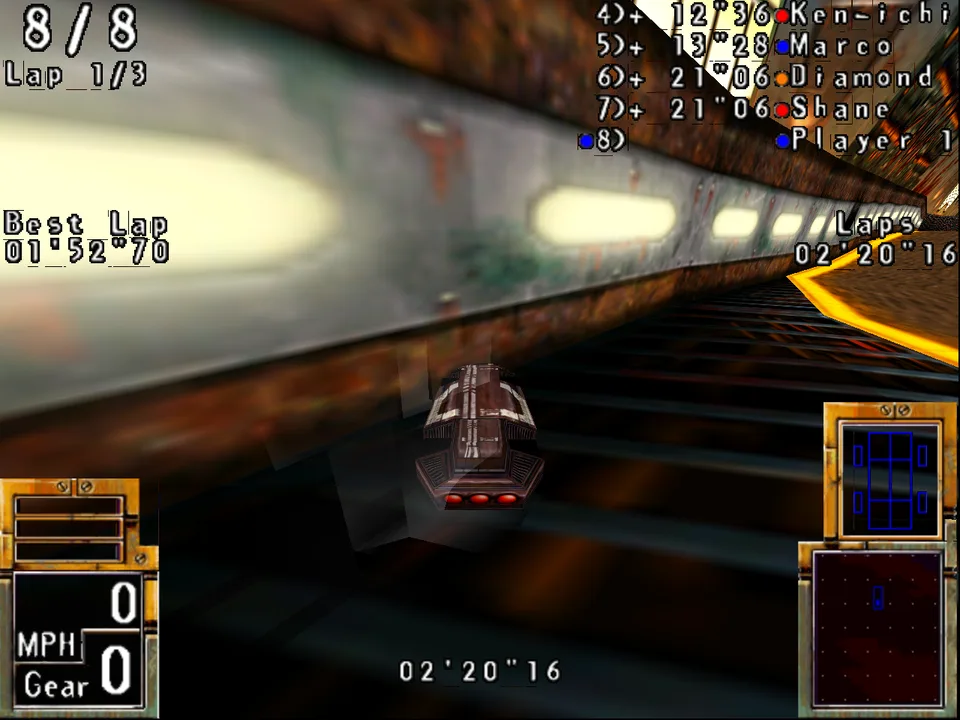
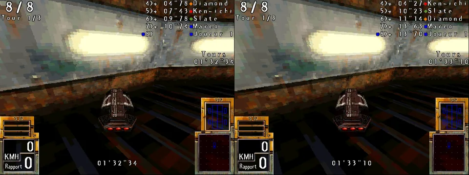
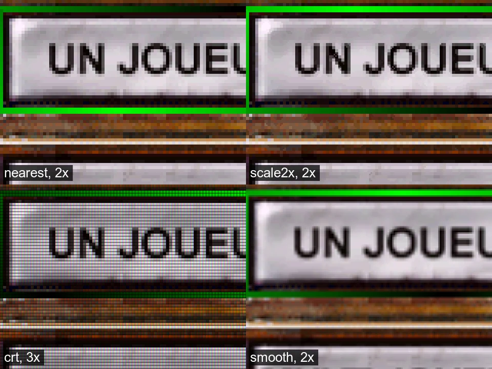
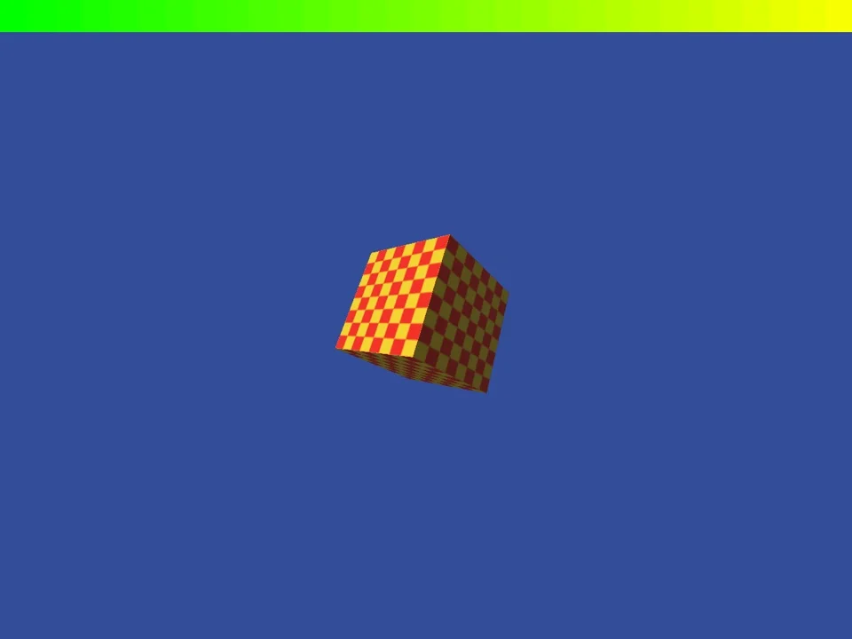
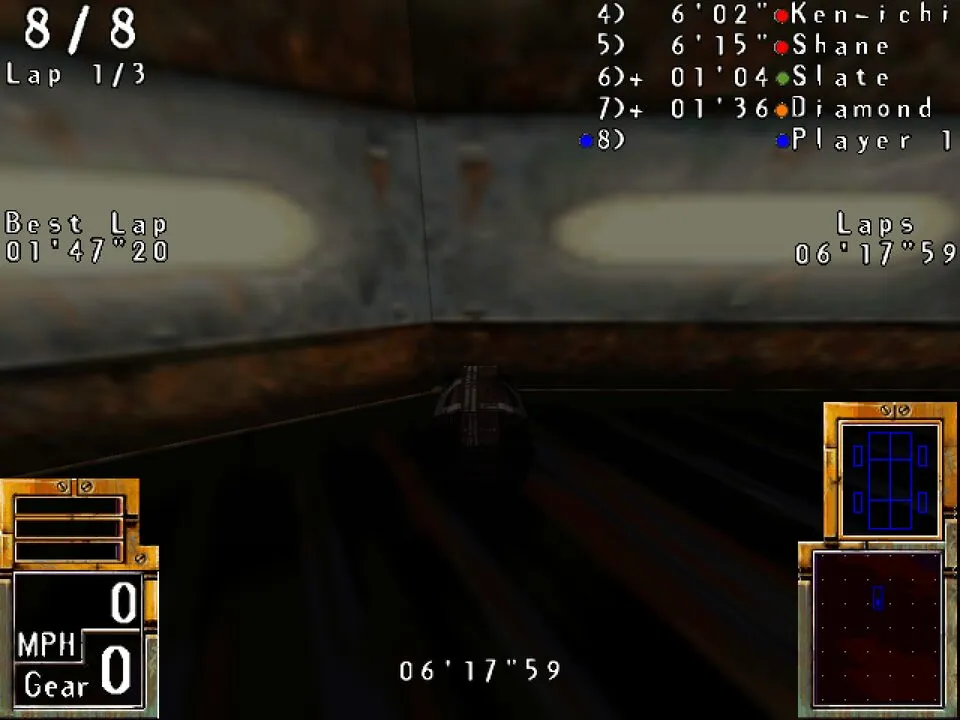

# Replacement 3D-card libraries



*POD Gold's 3dfx build, unchanged, in a race at 1280 × 960. GameFrame's `glide2x.dll` draws it
with OpenGL. The original card drew 640 × 480.*

GameFrame's `wrappers/` folder holds stand-in DLLs for the 3D-card libraries that late-1990s
Windows games called. Each one has the file name and the exports of the original library. The
game's EXE loads it in place of the card's driver and runs unchanged. The DLL draws the
picture on a modern machine, at a size you choose. No 3D card from the 1990s is needed.

The libraries are written in Rust and built for 32-bit Windows. They have been tested with one
game so far, POD: Planet of Death. They implement only the calls POD makes.

## Why a game had one build per card

In 1997 each maker of 3D cards had its own programming interface. 3dfx had Glide. ATI had
ATI3DCIF for the Rage. S3 had the S3D Toolkit for the ViRGE. PowerVR had SGL. Microsoft's
Direct3D was one more choice. So a studio often shipped one EXE per card, each linked to that
card's library. POD's first disc, in 1997, holds five builds: software, MMX, 3dfx, ATI and S3.
POD Gold adds a Direct3D build and a PowerVR build.

Today none of those libraries exists on a new system. The cards are rare. A build
made for one of them stops at its first call, or before it starts. The software build often
still runs, but it draws at 640 × 480 or less. The card builds usually look better: filtered
textures, fog, transparency and light effects. The page [The card makers' 3D
APIs](card-apis.md) shows how to read each API in a game's code.

## What a stand-in DLL does

A stand-in DLL exports the same functions as the original, under the same names and calling
conventions. When the game calls one, the stand-in does what the card would have done, with
today's graphics libraries. How much it can improve the picture depends on the API.

- **The game sends the whole scene.** Glide and SGL receive every triangle, texture and state
  of the 3D picture. The stand-in can draw all of it again with OpenGL at any resolution. The
  result is sharp at 1280 × 960 or larger.
- **The game draws most of the picture itself.** POD's ATI and S3 builds draw the textured
  scene in software, into a DirectDraw surface at 640 × 480. The chip only adds a few faces,
  such as the cars' shadows and the light beams. The stand-in draws those faces in software as
  well. `ddraw.dll` then scales the finished frame up. The scaled frame has no more detail
  than the original. Its edges stay clean.

Each library exports every call of the original, so any game that uses the library loads.
The calls not written yet are stubs. A stub logs its call with its arguments and returns a
failure value. When the game exits, the library lists every stub and every unhandled mode the
game met, with a count. The log of a new game's first run then lists what to write next
([Reading the logs](#reading-the-logs)). The aim is a full replacement for each library.

## The libraries

| DLL | Stands in for | What it draws | State | Known gaps |
|---|---|---|---|---|
| [`glide2x.dll`](../../wrappers/glide/README.md) | 3dfx Glide 2.x (`glide.dll`, `glide2x.dll`) | The whole scene with OpenGL, at any size. The Voodoo's colour combiners, alpha test, chroma key and table fog are one fragment shader. The W buffer is OpenGL's depth test. Mipmaps, NCC and multibase textures, the `gu` texture manager and 3DF files | All 156 calls (Glide 2.43 and 2.1.1). POD's 3dfx builds (first edition and Gold) race at 1280 × 960 | Only TMU 0 draws, so no detail textures. No antialiased edges or dither. `GR_BLEND_PREFOG_COLOR` is taken as zero |
| [`sgl.dll`](../../wrappers/sgl/README.md) | PowerVR PCX1 and PCX2, SGL's scene graph and its immediate mode | It keeps the scene graph the game builds, or takes the faces it sends each frame (`sgltri_*`), and draws them with OpenGL. The 2D picture goes on top through `ddraw.dll` or SGL's own 2D callback | 61 of 134 calls (60 of SGL's 133, and one for `ddraw.dll`). POD Gold's PowerVR build races at 1280 × 960. The immediate mode is tested only with our own program | Shadow volumes, and convex objects other than light volumes, are skipped |
| [`ati3dcif.dll`](../../wrappers/ati3dcif/README.md) | ATI 3D Rage (ATI3DCIF) | Solid, flat and Gouraud triangles and quads, blended by source alpha, in software into the game's DirectDraw surface | 6 of 17 calls. POD's ATI build races with the frame scaled | No textures, lines, rectangles, points, Z buffer or fog. Whether the Rage rounded edges the same way is *unknown* |
| [`s3dtkw.dll`](../../wrappers/s3dtkw/README.md) | S3 ViRGE (S3D Toolkit) | Gouraud lists, strips and fans, blended by source alpha, in software into a 15-bit or 8-bit surface | All 6 calls, and 3 slots of the function table. POD's S3 build races with the frame scaled | Textured faces are drawn Gouraud. Fog is logged and not drawn |
| [`ddraw.dll`](../../wrappers/ddraw/README.md) | DirectDraw 1 to 3 | Every surface in memory and every mode granted. Each flip shows the frame in a window, scaled | 2 of 9 calls, and the methods of DirectDraw 1 to 3 that POD calls. Used by POD's ATI, S3 and PowerVR builds. Made for its software and MMX builds too (not confirmed with them) | No Direct3D. `DDRAW_SYSTEM=1` hands DirectDraw to the system's own library for a game that needs it. Methods POD does not call return `DDERR_UNSUPPORTED` |
| [`94DLL32.dll`](../../wrappers/maxi94/README.md) (`maxi94`) | Guillemot Maxi Sound 64 (Dream SAM9407), the sound card library | No picture. The card's wave streams are Wine's wave outputs, and the mixer's wave and CD lines are answered for, so the game's sound plays | 6 exports by ordinal. POD Gold's `PODMAX64` races with its sound effects in the emulated PC (Wine on Linux, recorded) | Front and rear mixed into two speakers. Sample banks, the chip's voices and its effects are not exported. [Sound-card APIs](sound-card-apis.md) has the other cards |

The libraries share four crates:

- [`shim`](../../wrappers/shim/README.md): the shared settings, port I/O as Windows 95
  allowed it, patches to the game's code in memory, and the log with its stubs.
- [`raster`](../../wrappers/raster/README.md): a small software triangle rasteriser for 8-,
  15- and 16-bit frame buffers.
- [`scalers`](../../wrappers/scalers/README.md): whole-multiple, Scale2x and CRT-style
  scalers for a finished frame.
- [`pixels`](../../wrappers/pixels/README.md): RGB555 and RGB565 to 8-bit colour.



*POD's ATI build (left) and S3 build (right) at the start of the same race. The game drew
these frames in software. Each chip added only the cars' shadows and light beams.*

### Other projects

Glide is well covered already. [nGlide](https://www.zeus-software.com/downloads/nglide) and
[dgVoodoo 2](https://dege.freeweb.hu/dgVoodoo2/) are mature and run many games. dgVoodoo also
covers DirectDraw and early Direct3D. Use them when they run your game. Stand-ins for
ATI3DCIF, the S3D Toolkit and PowerVR's SGL are rare. Those three libraries are the less
common part of this workspace. The Glide library is here because it was built with the others.
It uses the same settings, patches and logs.

## Build them

You need Rust with the 32-bit Windows target, and zig 0.17 as the linker. No MinGW toolchain is
needed.

```bash
rustup target add i686-pc-windows-gnu
cd wrappers && cargo build --release     # for playing
cd wrappers && cargo build               # for working on a library
```

The two builds go to their own folders:

| | Release | Debug |
|---|---|---|
| Folder | `wrappers/target/i686-pc-windows-gnu/release/` | `wrappers/target/i686-pc-windows-gnu/debug/` |
| Speed | Fully optimised, with link-time optimisation | Lightly optimised, so a game still runs |
| Symbols | Stripped | Kept, for a debugger |
| Stubs and unhandled modes | The first call of each logged | The first 50 of each logged |
| OpenGL errors | Not checked | Logged after each frame (`glide2x.dll`, `sgl.dll`) |
| Size of a DLL | About 0.4 to 1.2 MB | About 6 to 10 MB |

Both builds count every stub and unhandled mode. They list them when the game exits. The first
line of each log names the build.

`wrappers/.cargo/config.toml` sets the target and links through GameFrame's `scripts/zcc.sh`.
zcc takes each DLL's exports from the `.def` file in its crate, so each DLL exports exactly the
original library's names.

To draw, `glide2x.dll` and `sgl.dll` need OpenGL. Software OpenGL works. Under Wine without a
GPU, Mesa's llvmpipe draws. A 32-bit game needs 32-bit OpenGL libraries. On Debian these are
`libgl1:i386 libglx-mesa0:i386 libgl1-mesa-dri:i386`.

## Use them with a game

You need your own copy of the game. Keep its files outside GameFrame.

1. **Find the libraries the game imports.** `./gameframe run peinfo GAME.EXE --imports` lists
   them. A game that loads its card library at run time names it only in its strings
   (`./gameframe run strings GAME.EXE | grep -i dll`).
2. **Copy the DLLs beside the game's EXE, under the names the game asks for.** An early Glide 2
   game imports `glide.dll`, so rename `glide2x.dll` for it. The ATI, S3 and PowerVR
   libraries need `ddraw.dll` beside them too, because they draw into its surfaces.
3. **Tell Wine to load the copies.** Wine has its own `ddraw.dll`, and some prefixes have a
   Glide wrapper. Set an override for each DLL you copied:

   ```bash
   WINEDLLOVERRIDES="ddraw=n,b;sgl=n;glide=n;glide2x=n" wine GAME.EXE
   ```

   On Windows the DLL beside the EXE is loaded first. Some versions of Windows take
   `ddraw.dll` from the system folder anyway. A `GAME.EXE.local` folder or an application
   manifest then makes Windows load the copy.
4. **Set the variables.** Each DLL reads its settings from environment variables. Wine passes
   the Unix environment to the game.
5. **Run the game, and read the logs.**

### The variables

Every DLL reads these shared variables through `shim`.

| Variable | Meaning | Default |
|---|---|---|
| `WRAPPER_WINDOW_CLASS` | The class name of the game's main window. `glide2x.dll` and `sgl.dll` draw into it. Look for it near `RegisterClassA` in the game's strings, or in its `CreateWindowExA` call. POD's is `Fenetre Pod` | the first visible top-level window of the process |
| `WRAPPER_MARKER` | The RGB565 colour that means "not drawn" in a 2D picture laid over the 3D frame, in hex (`0x0821`) or decimal. Choose another if the game draws this exact colour | `0x0821`, almost black |
| `WRAPPER_PATCHES` | A file of patches to the game's code, applied in memory at load | none |

Each library also reads its own variables.

| Variable | Library | Meaning | Default |
|---|---|---|---|
| `GLIDE_SCALE` | glide | Output size as a multiple of the game's (`2`, `4`, `1.5`) | 2 |
| `GLIDE_SIZE` | glide | Output size in pixels (`1920x1440`). It wins over the scale | |
| `GLIDE_LFB_FILTER` | glide | `linear` smooths the game's 2D pictures when scaled | `nearest` |
| `GLIDE_SCALE_FILE` | glide | A file holding a scale, read again each time the game opens the card | |
| `SGL_SCALE` | sgl | The 3D frame's size as a multiple of the device's | the window's |
| `SGL_FOG` | sgl | A factor on SGL's fog density | 1 |
| `SGL_PRESENT` | sgl | `0` shows the 3D frame alone, without the game's 2D picture | 1 |
| `SGL_TRACE` | sgl | Log the first N calls of each function, with their arguments | 0 |
| `SGL_SHOT_DIR`, `SGL_SHOT_EVERY` | sgl | Save every Nth picture shown as a BMP in that folder | none, 100 |
| `DDRAW_SCALE` | ddraw | The window as a multiple of the game's mode | 2 |
| `DDRAW_FILTER` | ddraw | `nearest`, `scale2x`, `crt` or `smooth` | `nearest` |
| `DDRAW_PIXELS` | ddraw | `555` for 5-5-5 surfaces. The S3 build needs it, since a ViRGE draws only 15-bit | 565 |
| `DDRAW_SYSTEM` | ddraw | `1` hands DirectDraw to the system's own `ddraw.dll`, for a game that needs Direct3D. The patches still apply | 0 |

The log files are `GLIDE_LOG`, `SGL_LOG`, `DDRAW_LOG`, `ATI3DCIF_LOG`, `S3DTK_LOG` and `MAXI94_LOG`. Each
names a file, such as `C:\glide.log`. Without it, the library logs to standard error.



*One menu button from POD's ATI build through each `DDRAW_FILTER`: `nearest` and `scale2x` at
2×, `crt` at 3×, `smooth` at 2×.*

### A patch file

Some games check for things a modern system cannot give them. POD Gold's 3dfx build reads the
CPU type and stops on a CPU it does not know. It also checks for a 16-bit desktop, which Wine
cannot report. A patch file changes those bytes of the game's code in memory when the DLL
loads. The EXE on disk stays unchanged. Keep the patch file in the game's own repository,
because it holds bytes of the game's code.

A patch file has one patch on each line. Spaces or tabs split the fields.

```text
# stamp     build         address   old bytes       new bytes       why
0x345270ab  GAME3DFX.EXE  0x486aa1  c705001122ff    c70500112204    unknown CPU: kind 4 (Intel P6)
```

| Field | Meaning |
|---|---|
| stamp | The EXE's `TimeDateStamp` from its PE header (`./gameframe run peinfo GAME.EXE`). A patch applies only to the build with this stamp |
| build | A name for the log |
| address | The virtual address in the loaded EXE, in hex or decimal |
| old, new | Hex bytes of the same length. The patch applies only when the bytes at the address are `old` |
| why | The rest of the line, written to the log |

Blank lines and lines that start with `#` are skipped. A line that does not parse stops the
whole file, and the log names the line. When several DLLs in one process read the file, the
first applies each patch and the others find the new bytes already in place. The parser is
`parse_patches` in [`shim/src/config.rs`](../../wrappers/shim/src/config.rs).

### Reading the logs

Every library writes the same three kinds of line:

```text
glide: release build, GameFrame wrappers 0.1.0
glide: not implemented: guMPInit() (later calls are counted)
glide: not handled: grTexDetailControl: detail textures need a second TMU; ignored (later calls are counted)
glide: not implemented or not handled, by count: grTexDetailControl ×812, guMPInit ×1
```

- `not implemented` is a call to a stub, with its arguments as 32-bit words.
- `not handled` is a mode, state or kind of object that an implemented call does not draw yet.
- The last line comes when the game exits. It lists everything the game met that the library
  lacks, most frequent first. If it reads "every call this game made is implemented", nothing
  was missing.

`ddraw.dll` names each COM method that is a stub, such as `IDirectDrawSurface::GetDC`. Some
libraries log more of their own. The ATI library logs the first four values of each state the
game sets. The S3 library logs each call to a slot of its function table that it does not fill.
`SGL_TRACE=N` logs the first N calls of each SGL function. The applied patches are logged with
their reasons. `glide2x.dll` also logs frames per second, and `sgl.dll` pictures a second. That
shows whether the output size is too large for the machine.

## Add a game

1. Find the card libraries it imports, and copy the stand-ins beside it, as above.
2. Find its window class and set `WRAPPER_WINDOW_CLASS`.
3. Run it, and read the log. The list at the end names each call and mode the game needs.
4. If the game stops before its first card call, look for a hardware check: the CPU, the
   desktop's colour depth, the card's name or its memory. Write a patch for it, in the game's
   own repository.
5. Add each missing call (below).
6. Record what the game needed in its own project, and the generic part in the library's
   README.

The page [Replacement libraries for a 1990s game](replacement-libraries.md) has the method in
more detail. It covers probes that log every call with its arguments, what such games assume
about windows, threads and the frame buffer, and how to measure what a card was given.

## Add a missing call

Every call of the original is already exported as a stub. Each library's `api.tsv` lists them
all. `tools/pe/apitable.py` read the convention and argument bytes of each call from the
original DLL's own code. For ATI3DCIF, which had no DLL at hand, it read them from the SDK's
import library.

1. **Find the call in the original API.** The card makers' SDK headers give its arguments and
   structures. [The card makers' 3D APIs](card-apis.md) lists sources for each.
2. **Find how the game uses it.** Trace the call site in the game's code. Note which arguments
   it passes and what it does with the result.
3. **Write it in the library's `api` module**, beside the calls of the same kind, with
   `#[unsafe(no_mangle)]`. Keep the original's name and calling convention: `extern "system"`
   for stdcall, `extern "C"` for cdecl. `api.tsv` says which.
4. **Run `python3 wrappers/stubgen.py`.** It removes the stub and keeps the export. It stops with
   an error if the call has the wrong convention. `tests/run.sh` runs it with `--check`.
5. **Test it on the host if it holds logic.** The rasteriser, the scalers, the settings and
   SGL's scene graph are plain Rust with host tests. Put new logic there when you can.
6. **Mark each difference from the card** with a `Deviation:` comment in the code, and list it
   in the README.

GameFrame keeps no game material. A test for a new call uses our own code, such as
`sgltest.c`. It never uses a game's files.

## Testing

`tests/run.sh` builds the release and debug DLLs, runs the host tests, checks each export table
against its `.def` file, checks that the `.def` files and stubs match the API tables, and builds
`sgltest.exe`, `sgltritest.exe` and `glidetest.exe` when zig is installed. A stub's argument bytes are checked when the DLL links. The
`.def` file names each stdcall export by its decorated name, such as `grAADrawLine@8`. Rust
gives a function that name only when it takes exactly 8 bytes of arguments. To run the host
tests alone:

```bash
cd wrappers && cargo test --release --target "$(rustc -vV | sed -n 's/^host: //p')" -p raster -p scalers -p pixels -p shim -p sgl -p glide
```



*`sgltest.exe` through `sgl.dll`. The scene is our own.*

[`wrappers/sgl/test/sgltest.c`](../../wrappers/sgl/test/sgltest.c) draws a known scene through
`sgl.dll` without any game. It has a lit, textured and fogged cube, a floor, a light volume, a
translucent pane and a 2D bar over the marker colour. Build it and run it beside `sgl.dll`:

```bash
zig cc -target x86-windows-gnu -O2 wrappers/sgl/test/sgltest.c -o sgltest.exe -luser32
WRAPPER_WINDOW_CLASS=SglTest SGL_SHOT_DIR='C:\shots' SGL_SHOT_EVERY=30 SGL_SCALE=2 wine sgltest.exe 120
```

[`sgltritest.c`](../../wrappers/sgl/test/sgltritest.c) does the same for SGL's immediate mode
(`sgltri_*`). It draws a fogged floor, a Gouraud triangle, a turning textured quad, a
highlighted triangle and a translucent one. A 2D bar goes on top. Pass `ddraw` after the
frame count to use `sgl_use_ddraw_mode`'s 2D callback in place of the address callback.

[`wrappers/glide/test/glidetest.c`](../../wrappers/glide/test/glidetest.c) draws a known scene
through `glide2x.dll` and checks it. It reads pixels back with `grLfbReadRegion` and prints one
line per check: culling, clipping, `gu` and NCC textures, the alpha test, fog, points, an LFB
write, saved state, a 3DF file and the queries. Its exit code is the number of failed checks:

```bash
zig cc -target x86-windows-gnu -O2 wrappers/glide/test/glidetest.c -o glidetest.exe -luser32
WINEDLLOVERRIDES=glide2x=n GLIDE_SCALE=2 wine glidetest.exe 120
```

The other libraries have no such test program yet. They were checked against POD's own runs.

## The worked example: POD



*POD Gold's PowerVR build in a race, drawn by `sgl.dll` at 1280 × 960, with fog and shading as
PowerVR's own driver does them.*

The libraries were written in the [POD: Planet of Death
project](https://github.com/tanepiper/pod-planet-of-death) for POD Gold 2.8 and later moved
here. The [POD case study](../case-studies/pod.md) has the summary. How POD uses each call of
each API, with evidence, is in POD's [3D cards
page](https://tanepiper.github.io/pod-planet-of-death/hardware/3d-cards). POD's diary has
entries on each library:

- [A Voodoo of our own](https://tanepiper.github.io/pod-planet-of-death/diary/2026-10-23-a-voodoo-of-our-own):
  the first Glide library, and the first race at twice the original size.
- [Gold on our Voodoo](https://tanepiper.github.io/pod-planet-of-death/diary/2026-10-24-gold-on-our-voodoo):
  the later Glide 2 calls, and the two patches POD Gold needed.
- [The ATI and S3 builds](https://tanepiper.github.io/pod-planet-of-death/diary/2026-10-24-the-ati-and-s3-builds):
  DirectDraw in memory, and why the two chips drew only the shadows.
- [Sharper frames](https://tanepiper.github.io/pod-planet-of-death/diary/2026-10-24-sharper-frames):
  the four filters of `ddraw.dll`.
- [A stand-in for PowerVR's SGL](https://tanepiper.github.io/pod-planet-of-death/diary/2026-10-24-powervr-sgl),
  [The PowerVR build races](https://tanepiper.github.io/pod-planet-of-death/diary/2026-10-24-powervr-race) and
  [PowerVR's own driver as the reference](https://tanepiper.github.io/pod-planet-of-death/diary/2026-10-24-powervr-driver):
  the scene graph, the light volumes, and the fog and shading taken from PowerVR's driver.

The table gives the result for each of POD's builds.

| Build | Libraries | Result |
|---|---|---|
| 3dfx (first edition and Gold) | `glide2x.dll` | Races at 1280 × 960 |
| PowerVR (Gold) | `sgl.dll`, `ddraw.dll` | Races at 1280 × 960 |
| ATI Rage | `ati3dcif.dll`, `ddraw.dll` | Races, the frame scaled |
| S3 ViRGE | `s3dtkw.dll`, `ddraw.dll` (`DDRAW_PIXELS=555`) | Races, the frame scaled |
| Direct3D (Gold) | `ddraw.dll` with `DDRAW_SYSTEM=1` | Next to run |

All of these runs were under Wine in an emulated x86 Linux PC. Under Wine on Apple silicon,
POD faults in the menus with these libraries or without them (know-how entry
`wine-wow64-rosetta-fault`). In software OpenGL a PowerVR race runs at about 3 pictures a
second. Play needs a real GPU.

## Limits and next steps

- **One game.** Each library implements the calls POD makes. It stubs the rest. A second game
  for each card would show how general they are. For example, Hardwar's PowerVR mode uses SGL's
  immediate-mode half, which is only stubs so far ([GAPS.md](../../GAPS.md)).
- **OpenGL only.** The drawing goes through OpenGL. Vulkan and Metal back ends are a later step,
  for machines where OpenGL is slow or missing.
- **No run on real Windows yet.** All testing so far was under Wine. Windows 10 and 11 may load
  `ddraw.dll` from the system folder, and their OpenGL drivers differ from Mesa.
- **No built release.** You build the DLLs yourself for now. A release of built DLLs would let
  players use them without Rust or zig.
- **No exact match with the cards.** The libraries draw what the game asked for. Where a card's
  exact rounding or blending is not known, the README says so and the code marks it.

Code: Apache-2.0. This page: CC0-1.0.
