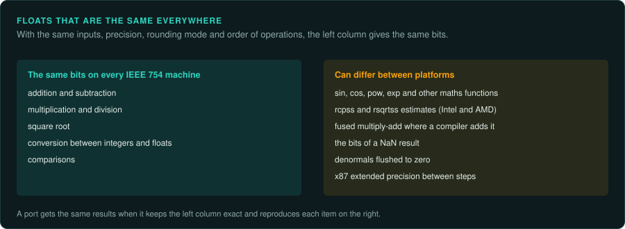

# The same floats on every platform

A port of a game that uses floating point must give the same numbers as the original, often on
a different CPU and in a different language. IEEE 754 makes this possible for the basic
operations. Several other things still differ between platforms. This page lists them, from
the point of view of the port. [Calling conventions and floating point](../ABI.md#floating-point)
covers the x87 and SSE instructions in the original, and [CPUs and floating
point](../hardware/cpus.md) the history.

## What IEEE 754 makes exact

Addition, subtraction, multiplication, division and square root are correctly rounded. Given
the same inputs, the same precision and the same rounding mode, every IEEE 754 machine gives the
same bits. So does a conversion between an integer and a float. A port that does the same
operations, in the same order, at the same precision, gets the original's results on any modern
CPU.

Each condition matters:

- **The same order.** Float addition is not associative. `(a + b) + c` and `a + (b + c)` can
  differ in the last bit. Keep the original's order of operations, and keep compilers from
  changing it (no `-ffast-math`, no `/fp:fast`).
- **The same precision.** A `float` sum that the original stored after each step must be
  rounded to `float` after each step in the port. x87 code that kept 80 bits between steps
  needs the extra precision at the same places.
- **The same rounding mode.** Round to nearest, ties to even, unless the original changed the
  mode. A game that sets the mode for a fast float-to-integer conversion changes it for every
  other operation too.

## What still differs

| Item | Where it differs | What to do |
|---|---|---|
| Maths functions (`sin`, `pow`, `exp`) | Every C runtime, every language and every GPU has its own versions, which differ in the last bit | Port the original's routine, or the routine of its C runtime, and test it against the original |
| Estimate instructions (`rcpss`, `rsqrtss`) | Intel and AMD CPUs give different results; only a maximum error is specified | Measure them on the CPU the reference captures came from, and use a table or a formula that gives those bits |
| Fused multiply-add | A compiler may fuse `a * b + c` into one rounding | Fuse only where the original's instruction did; turn contraction off elsewhere |
| NaN bits | A NaN made from numbers (`0 / 0`, infinity minus infinity) is negative on x86 (`0xFFC00000` for a float) and positive on ARM (`0x7FC00000`); WebAssembly allows either. A NaN that comes in as an operand goes out unchanged, apart from being made quiet, on x86 SSE and on ARM in its default mode. An x86 `mulss` and a Rust build on ARM both return a `0x7FC00000` input as `0x7FC00000` (*measured*) | Matters only if the game stores, hashes or compares NaN bits; then keep the original's operations, so that a NaN input passes through the same way |
| Multiplying by −1 | The original's `x * -1.0` returns a NaN unchanged. A compiler may turn the port's `x * -1.0` into a negation, which flips the NaN's sign bit: LLVM does this in a release build (*observed*). Writing `c - x` instead loses the `-0` that the multiply gives at `x = c` | Negate only a number, and pass a NaN through: `if x.is_nan() { x } else { -x }` |
| Denormals | 32-bit ARM NEON always flushes them to zero; games may set flush-to-zero on x86 | Copy the original's setting, and test with very small values |
| Text to number | `atof` and `strtod` were not always correctly rounded in old runtimes, and they read the decimal separator from the locale | Parse with the original's routine, or check every number the game reads from text |

## Platforms with their own rules

- **PlayStation.** No floating-point unit. The geometry coprocessor (GTE) works in fixed point.
  See [Integers on every platform](integers.md).
- **PlayStation 2.** The Emotion Engine's FPU is not IEEE 754. It has no infinities, no NaNs and
  no denormals, it rounds toward zero, and it clamps overflows to the largest value. Emulators
  such as PCSX2 add code to copy this, and a port must do the same.
- **GameCube and Wii.** Paired-single instructions compute two floats at once. Their estimate
  instructions (`ps_res`, `ps_rsqrte`) give the console's own results, which Dolphin reproduces
  from measurements.
- **GPUs.** Shader arithmetic is not required to be IEEE-exact, and `mediump` may use 16-bit
  floats. Results used by the game's rules must be computed on the CPU.

## In the port's language

- **Rust.** `f32` and `f64` operations are IEEE operations, and the compiler does not reorder
  them. `f32::sin` and similar call the platform's maths library, so they differ between
  platforms. Write the original's versions instead. The compiler may still rewrite an
  operation into another one with the same result for every number, such as `x * -1.0` into
  `-x`. Such a rewrite can change the bits of a NaN (see the table above). `f32::min`,
  `f32::max` and `f32::clamp` also treat NaN in their own way: `min` and `max` return the
  other value, and `clamp` returns the NaN. Port the original's comparisons instead of these
  functions where a NaN can reach them.
- **JavaScript.** Every number is a 64-bit double. `Math.fround` rounds to 32 bits, so a `float`
  operation is `Math.fround(Math.fround(a) * Math.fround(b))`. `Math.sin` and the other
  functions are implementation-defined and differ between browsers.
- **WebAssembly.** `f32` and `f64` operations are IEEE operations with one rounding each. Only
  the bits of NaN results may vary. There are no fused operations unless the code asks for them.
- **C#.** On .NET Core, `float` operations use SSE and round to `float`. On the old .NET
  Framework for 32-bit x86, the JIT used the x87 and kept extra precision. Unity games running
  on Mono may also show this. Check which runtime the original used.

## How to check

1. Run each float routine of the original under emulation on many inputs, including values
   near zero, near overflow, negative zero and NaN ([re-emulate](../../skills/re-emulate/SKILL.md)).
   Some C runtime routines handle NaN and infinity on a separate path. MSVC's `sqrtf` passes
   them to its maths error handler, which an emulator that has not started the runtime does
   not have, so the emulation stops there (*observed*). Read that path in the disassembly, or
   start the runtime first.
2. Compare the port's bits exactly with `tools/verify/bitcompare.py`, with no tolerance.
3. Run the same comparison on every platform the port ships on, including the browser.
4. When a value differs, find the first operation that differs. It is usually an order of
   operations, a missing rounding to `float`, or a maths function.

## What to record

- The precision of each value the rules use, and where the original rounds it.
- The rounding mode and the denormal setting at start-up, and any later changes.
- Every maths function and estimate instruction the rules use, and how the port reproduces it.
