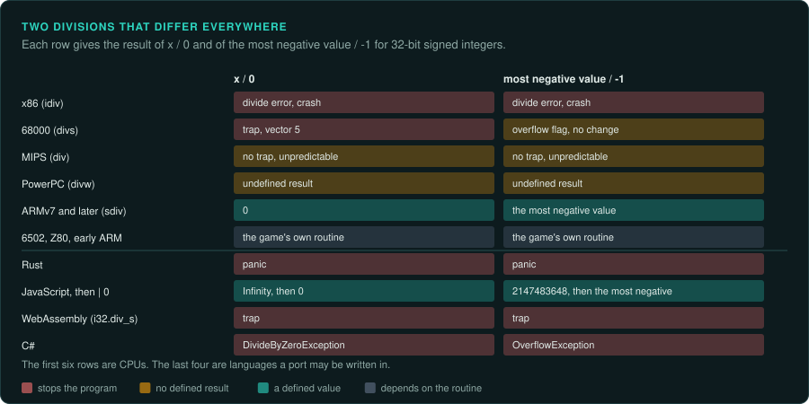

# Integers on every platform

Integer arithmetic looks the same everywhere until a value reaches an edge, such as a division
by zero, the most negative number divided by -1, a shift by the full width of the register or a
sum that does not fit. At those edges each CPU does something different. Each language that a
port may be written in also does something different. The original game shows one behaviour. The player may see it as a
crash, a wrapped score or a unit that jumps across the map. The port must show the same one.

This page lists the edges on the CPUs that games ran on, and the ways to reproduce each in a
port. [Calling conventions and floating point](../ABI.md#integers) covers the instructions,
signed and unsigned compares and C's integer promotion. The facts here come from the CPU
manuals and the language references.

## Division

| CPU | Divide by zero | Most negative value / -1 |
|---|---|---|
| x86 (`div`, `idiv`) | Divide error (interrupt 0) | Divide error, because the quotient does not fit |
| 68000 (`divs`, `divu`) | Trap through vector 5 | Overflow flag set, the destination left unchanged |
| MIPS (`div`, `divu`) | No exception; the result in HI and LO is unpredictable | No exception; the result is unpredictable |
| PowerPC (`divw`) | No exception; the result is undefined | No exception; the result is undefined |
| ARM (`sdiv`, `udiv`, ARMv7 and later) | Returns 0 | Returns the most negative value |
| 6502, Z80, SH-1, early ARM | No divide instruction | The game's own routine decides |

**On x86 a bad division ends the program.** Under DOS, the default handler for interrupt 0
prints "Divide overflow" and returns to DOS. Under Windows the program gets an
`EXCEPTION_INT_DIVIDE_BY_ZERO` or `EXCEPTION_INT_OVERFLOW` exception, and without a handler it
closes. If the original can reach such a division, the player sees a crash, and the port must
decide whether to copy it. Record the decision as a deviation if the port does something else.

**On MIPS the compiler adds the check.** GCC for MIPS places a `teq` or `break 7` after a
division to trap on a zero divisor. A PlayStation or Nintendo 64 game built without that check
gets whatever HI and LO hold. Measure that value on the emulator the project trusts, or show
that the game never divides by zero.

**Without a divide instruction, the routine is the specification.** 8-bit games and many ARM
games before ARMv7 divide in a loop or call a library routine. The Game Boy Advance has a
divide function in its BIOS. Each routine has its own answers for zero and for negative
values. Port the routine, or run it under emulation on the edge cases and copy its results.

**The sign of the remainder.** C99 and C++11 round the quotient toward zero, so the remainder
takes the sign of the dividend: `-7 % 2` is `-1`. C89 left this to the compiler for negative
operands. Compilers for x86 followed `idiv`, which also rounds toward zero. Python's `%` takes
the sign of the divisor instead, so `-7 % 2` is `1` there.

## Shifts

| Shift by N, register of W bits | Result |
|---|---|
| x86 from the 80186 on | The count is masked to 5 bits (6 bits for 64-bit operands), so a 32-bit shift by 32 shifts by 0 |
| 8086 and 8088 | The count is not masked; a large count shifts every bit out |
| ARM, count in a register | The bottom byte of the count is used; a count of 32 or more gives 0 for `lsl` and `lsr`, and all sign bits for `asr` |
| C and C++ | Undefined when N is negative or at least W |
| Java, JavaScript, WebAssembly | The count is masked to the width (5 bits for 32-bit values) |

A game compiled for x86 that shifts by a computed count gets the masked result. The same C code
compiled for ARM gives a different one. Read the instruction in the original, and write the
port's shift so that it masks the count the same way.

`sar` keeps the sign and `shr` does not. A signed right shift rounds toward minus infinity, so
`-7 >> 1` is `-4`. A division by 2 rounds toward zero and gives `-3`. Compilers turn a signed
division by a power of two into a shift with a correction for negative values. The correction is
missing when the source used a shift.

## Wrapping, saturating and decimal arithmetic

- **Wrapping.** Most integer instructions keep the low bits of the result. A 16-bit score that
  passes 65,535 starts again at 0. Copy the width of every variable, including the narrow ones
  in saves and in network messages.
- **Saturating.** MMX (`paddsw`, `paddusb`), ARM (`qadd`), NEON and many DSPs stop at the largest
  or smallest value instead of wrapping. Software mixers and colour arithmetic use them. A port
  that wraps where the original saturates gives loud clicks in sound and dark spots in pictures.
- **Binary-coded decimal.** The 6502 in decimal mode (`sed`), the Z80's `daa` and x86's `daa`
  keep two decimal digits in a byte. Scores and timers on 8-bit machines often use it. The NES
  CPU has no decimal mode, so NES games do the same work in their own code.
- **Signed overflow in C.** The C standard calls it undefined. An optimising compiler may then
  remove a test that the source seemed to contain, such as `if (x + 1 < x)`. The machine code is
  what ran, so read the behaviour from the instructions.

## The same results in the port

| Port language | Wrapping | Division edges | Shifts |
|---|---|---|---|
| Rust | Overflow panics in debug builds and wraps in release builds; use `wrapping_add` and the other `wrapping_*` methods to wrap in both | `/` and `%` panic on zero and on `i32::MIN / -1`; use `checked_div` and decide the result yourself | `<<` panics on a large count in debug builds; `wrapping_shl` masks the count |
| JavaScript | Numbers are doubles; `x \| 0` gives a 32-bit signed result, `x >>> 0` an unsigned one; `Math.imul` multiplies as 32-bit integers | `/` gives a fraction; use `Math.trunc(a / b) \| 0`; a zero divisor gives `Infinity`, which `\| 0` turns into 0 | The count is masked to 5 bits |
| WebAssembly | `i32.add` and the other operations wrap | `i32.div_s` traps on zero and on overflow; `i32.rem_s` traps on zero but gives 0 for the most negative value % -1 | The count is taken modulo the width |
| C# | Wraps unless the code is in a `checked` block | Divide by zero throws `DivideByZeroException`; `int.MinValue / -1` throws `OverflowException` | The count is masked to 5 bits for `int` |
| Python | Integers never overflow; mask with `& 0xFFFFFFFF` and convert the sign yourself | `//` rounds down; divide by zero raises `ZeroDivisionError` | No width, so mask after each shift |

Put the original's integer operations in a few small helper functions in the port. Write a
division with the original's rounding and edge cases, a shift with its masking, and an add
with its width. Test the helpers against the original under emulation on the edge cases
([re-emulate](../../skills/re-emulate/SKILL.md)), then use them everywhere.

## What to record

- The width and signedness of every variable that the port reproduces.
- Every division that can see a zero or the most negative value, and what the original does
  there.
- Every shift by a computed count, and how the original's CPU masks it.
- Any saturating or decimal arithmetic, with the routine that does it.
