# Library behaviour that shows in results

A game calls its C runtime and its standard library for random numbers, sorting, formatting,
time and containers. The C and C++ standards say what each function must do, but they leave
the details to each runtime. Microsoft's, Borland's, Watcom's and GNU's runtimes made different
choices. A port that calls its own runtime's `rand` or `qsort` gets different results from the
original, even when every line of the game's own code is exact.

This page lists the functions whose differences reach the player, and what to do about each.
The rule for all of them is the same. Find which runtime the game was linked with
([Recognising an engine](../engines/recognising.md#libraries-that-are-not-the-engine)), then port
that runtime's version of each function the rules use. GameFrame's
[crates](../crates/README.md) include some of them, such as the MSVC maths functions.

## Random numbers

`rand` returns the next number of a generator whose algorithm the standard does not fix.

| Runtime | Algorithm | After `srand(1)` |
|---|---|---|
| Microsoft C | state = state x 214013 + 2531011; return bits 16 to 30 | 41, 18467, 6334 |
| Borland C and Turbo C | state = state x 22695477 + 1; return bits 16 to 30 | 346, 130, 10982 |
| GNU C library (glibc) | an additive generator with 31 words of state | 1804289383, 846930886, 1681692777 |

`RAND_MAX` differs too: 32767 for Microsoft and Borland, 2147483647 for glibc. A game that
computes `rand() % 6` gets other dice in a port that uses another runtime. Port the original's
generator, keep its state where the original keeps it, and draw in the same order. The
`re-randomiser` agent finds every caller.

## Sorting

`qsort` is not stable, and each runtime sorts in its own way. Elements that compare equal come
out in an order that depends on the algorithm.

- **Microsoft C.** A quicksort with a median-of-three pivot, and an insertion sort for parts of
  8 elements or fewer.
- **glibc.** For many years a merge sort when it could allocate memory, which kept equal
  elements in order, and a quicksort otherwise. Later versions changed this.
- **C++ `std::sort`.** An introsort in every major library, with its own thresholds. Equal
  elements come out in a library-specific order.

A game that sorts units by distance, or sprites by depth, shows the order of equal elements on
screen or in its rules. Port the original's sort exactly, including its pivot choice and its
threshold. Un-Banished's `crt_qsort_by` is an example. A stable sort in the port gives a
different order.

## Formatting and parsing numbers

- **`printf` with floats.** The Universal CRT in Visual Studio 2015 changed how `printf`
  formats floating-point numbers, to print the exact decimal value and round it correctly. A
  game built with an older runtime can show a different last digit for the same value. Port the
  original's formatting where the game shows numbers or writes them to saves.
- **`atof` and `strtod`.** Old runtimes did not always round the parsed value correctly. A
  number read from a text file of rules can differ in its last bit between runtimes.
- **The locale.** A C program runs in the "C" locale until it calls `setlocale`. After
  `setlocale(LC_ALL, "")` on a German or French system, `printf` writes `3,5` and `atof` stops
  reading at the comma. See [Text and encodings](text.md#the-locale).

## Time

- **`clock`.** On Microsoft's runtime it returns the wall-clock time since the program started,
  in units of 1/1000 second. On POSIX systems it returns the processor time the program has
  used, in units of 1/1,000,000 second. A game that times its frames with `clock` runs at a
  different speed if the port takes `clock` from another runtime.
- **`time` and `localtime`.** The time zone and summer time rules come from the system. A game
  that shows dates or seeds its generator from the clock depends on them. Make the clock an
  input of the port ([Inputs](../observe/inputs.md)).

## Containers and hashing

- **Hash tables.** `std::unordered_map`, `stdext::hash_map` and similar containers iterate in an
  order set by the hash function and the bucket count. Each library has its own. A game that
  loops over a hash table and acts on each element in turn depends on that order.
- **Hashes of pointers.** A table keyed by object addresses iterates in an order set by where the
  allocator placed the objects. That order changes between runs, between runtimes and between
  allocators. If the original depends on it, its behaviour may differ from run to run. Record
  that as a finding before choosing what the port does.
- **`std::set` and `std::map`.** Ordered by their comparison, so the order is the same
  everywhere, as long as the comparison is the same.

## Memory functions

- **`memcpy` with overlapping buffers.** Undefined by the standard. The original's
  `memcpy` copied in a fixed direction, and a game that relied on it got that result. Use
  `memmove` in the port only if the original's result matches it.
- **Uninitialised memory.** The original read whatever was there, such as zeros from a fresh
  heap page or old data from a reused block. If a value comes from uninitialised memory, measure what the
  original got in practice, and give the port that value.

## What to record

- The C runtime and C++ library the game was linked with, with the evidence.
- Every library function the rules call, and how the port reproduces each one.
- Every place where the original's behaviour depends on addresses or on uninitialised memory.
