# Text and encodings

Text in a game is bytes in an encoding the game chose, drawn with a font the game chose, broken
into lines by the game's own rules. A port that reads the same bytes as a modern string type
can show other characters, break lines in other places, or read numbers wrongly on some
systems. This page lists what to find out about the original's text, and how to keep it the
same. [Identifying unknown files](../media/files.md) covers finding text in data files.

## Encodings

| Encoding | Used by | What to watch |
|---|---|---|
| ASCII | Most code and file names | 7 bits; anything above 127 belongs to another encoding |
| Code page 437 | DOS and the PC text mode | Box-drawing characters and accented letters above 127; the game's own font may change some of them |
| Windows-1252 | Western European Windows | Close to ISO 8859-1, with punctuation in 128 to 159 |
| Shift-JIS | Japanese PC and console games | One or two bytes per character; the first byte of a pair is 0x81 to 0x9F or 0xE0 to 0xEF |
| EUC-JP, GB2312, Big5 | Japanese, Chinese and Taiwanese games | Two bytes per character, each above 127 |
| UTF-16 | Windows wide-character functions, .NET, Unity | Two bytes per character for most text; letters with zero bytes between them in a file |
| The game's own | Many console and 8-bit games | A table of tile numbers, often in the order of the font |

A game with its own encoding stores a table that maps codes to glyphs, or draws code N from tile
N of its font. Find the table by placing known text next to its bytes. The first letters of a
title screen are often enough.

**Two-byte encodings and byte searches.** In Shift-JIS, the second byte of a character can be
any value from 0x40 to 0xFC, including 0x5C, the code of the backslash. A routine that looks for
a backslash or a quote one byte at a time finds it inside a Japanese character. Japanese fonts
also show 0x5C as a yen sign. Games handled this in their own string routines. The port must
step through text one character at a time, in the same way as the original.

## Lengths and positions

- **Bytes or characters.** A string's length in bytes differs from its length in characters in
  every multi-byte encoding. Text boxes, input fields and save slots usually limit bytes.
  Copy the original's limit in the same unit.
- **Fixed fields.** Names in saves and records often sit in fixed-size fields, padded with
  zeros or spaces, sometimes without a final zero. Read and write them in the same form.
- **Pointer tables.** Translated versions change the lengths of strings, so the game stores a
  table of offsets to each string. The table tells you where each string starts. It also shows
  that a translation can move every string after the first change.

## The locale

A C program uses the "C" locale until it calls `setlocale`. Then number formatting, case
conversion and sorting follow the system's settings.

- **The decimal separator.** With a German or French locale, `printf("%.1f")` writes `3,5`, and
  `atof("3.5")` stops at the point and returns 3. A game that reads its rules from text files can
  then get other numbers on those systems. .NET and Unity use the current culture by default in
  `ToString` and `Parse`, so the same problem appears in many Unity games.
- **Case.** `toupper` in the "C" locale changes only ASCII letters. With a Turkish locale, .NET's
  `ToUpper` turns `i` into a dotted capital `İ`, so a comparison of upper-cased names fails.
- **Sorting.** `strcmp` compares bytes. `strcoll` and .NET's culture-aware comparison sort by
  the locale's rules. Lists of names, saves and items show which one the original used.

The port must run the rules with the original's locale, whatever the player's system is. Find
where the original calls `setlocale`, or which culture it gives .NET, and fix the port to that.

## Fonts and line breaks

- **The font is part of the rules.** A bitmap font gives each character a width. Proportional
  fonts store a table of widths, and some store kerning pairs. Line breaking uses these widths,
  so a port with another font breaks lines in other places.
- **Line breaking.** Most games fill a line word by word and start a new line when the next word
  does not fit. The details differ between games. They include whether a space at the end of a line counts, how a word
  longer than the line is cut, and where control codes for colour or pauses sit. Port the
  original's routine and test it on the longest strings in the game.
- **Japanese rules.** Japanese text has no spaces. Games break it between characters, with rules
  (kinsoku) that keep some punctuation from starting a line. Each game has its own list.
- **Control codes.** Dialogue text often holds codes for the speaker's name, a pause, a colour or
  the player's input. List every code and what it does before porting the routine that draws
  the text.

## What to record

- The encoding of each kind of text in the executable, in data files and in saves.
- The font of each kind of text, with its width table, and the routine that breaks lines.
- Every call to `setlocale` or every culture setting, and how the port fixes the locale.
- The length limit of each input field and save field, and its unit.
