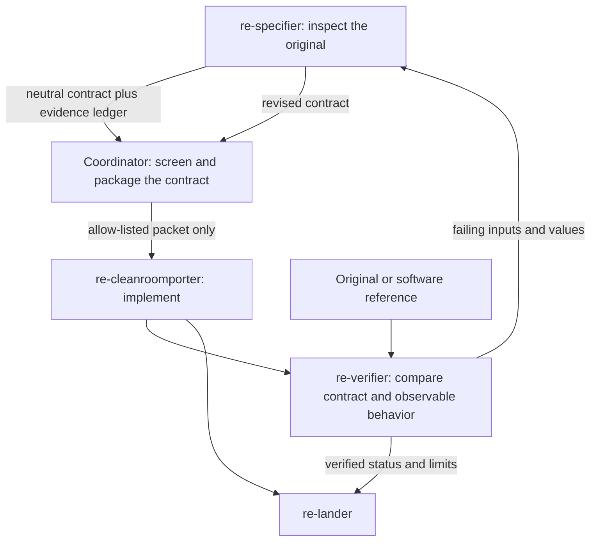

# Clean-room-style implementation team

Use this team when the project owner asks for a source-visible specification and a separate
source-blind implementation. Pick one bounded interface or behavior at a time.

## Steps

| Order | Agent | Brief | Hands on |
|---|---|---|---|
| 1 | `re-specifier` | "Specify the observable behavior of `<interface>`" | A behavior contract and a separate evidence ledger |
| 2 | Coordinator | "Prepare a source-blind packet for contract revision `<id>`" | An allow-list, hashes and a record of the access boundary |
| 3 | `re-cleanroomporter` | "Implement `<interface>` from this packet only" | New code, with the contract revision named |
| 4 | `re-verifier` | "Compare this implementation with the contract and software oracle" | Test vectors, observed outputs, mismatches and limits |
| 5 | `re-lander` | "Land this bounded slice and its evidence record" | Documentation, status update and commit |

When the verifier finds missing behavior, it reports the input and the expected and actual
results. The source-facing role resolves the behavior and updates the contract. The coordinator
then starts a fresh implementation task with a revised packet. Do not send source-derived
explanations to the implementer.

## Outcome

- A behavior contract whose statements point to a separate source evidence ledger.
- A new implementation written from an allow-listed packet.
- Software comparisons, known limits and suggested follow-up probes.
- A record of whether the separation was prompt-based, workspace-isolated or independently
  staffed.

## Choices for the main session

- The user chooses the scope, license and desired separation method.
- If the source files remain accessible to the implementer, describe the split as procedural.
  Use a separate workspace containing only the packet for a stronger file boundary.
- Keep the private evidence ledger out of the packet. Do not put decompilation or game files in
  GameFrame itself.
- Physical hardware is optional. A software oracle, a logging shim or a virtual device trace can
  settle many driver boundaries.
- Follow [Clean-room-style implementations](../working/clean-room-implementations.md) for the
  packet format, tool choices and implementation rules.
