# Working on a project

These pages describe how to organise the work of reverse engineering a game, for agents and
the people who direct them. The skills describe each step of the method. These pages cover the
work that spans several steps and several sessions.

- [Working well as an agent](agents.md): writing everything down in the repository, how to start a session,
  measuring before porting, working in subsystems, splitting work between sessions, what to
  do when stuck, and how to report.
- [Clean-room-style implementations](clean-room-implementations.md): source-visible specification,
  source-blind implementation, behavior contracts, packet limits and software-only verification.
- [The GameFrame MCP tool surface](mcp-toolchain.md): discover and run local tools through MCP,
  keep the server modular, and understand its boundaries with external providers.
- [Linux, cloud and container environments](environments.md): what an agent installs on Linux
  or in a cloud workspace, `scripts/env.sh` for each session, headless runs, REA, and game
  files on someone else's machine.
- [Getting more from Ghidra](ghidra.md): every call with its arguments, code that is not an
  executable, carrying labels to a new build, Function ID, types, processors.
- [Versions, patches and builds](versions.md): choosing the version to copy, comparing builds,
  and reading several versions' data in one port.
- [Reading the story for design decisions](lore.md): why the manual and the program's own
  text say what each system is for and which must be exact, with Hardwar as the worked
  example, and the lore step of the method.
- [A resource viewer from the first day](viewer.md): the catalogue of every file, then the
  project's own viewer on the port's readers, so people and agents can check decoded content.
- [Building the port](building-the-port.md): the core, the platform layer and the frame;
  time, input, drawing, sound, the player's data, the event contract between the core and the
  frame, browser builds and round trips of the original's formats.
- [Replacing the original one routine at a time](hybrid-port.md): running the original inside
  the port, the port contract, instruction counts, declining, shadow verification.
- [Practising on games with source](practice.md): practice targets, a ladder of exercises,
  and testing agents on games whose answers can be checked.
- [Keeping a game for the long term](preservation.md): archive packages, fixity with BagIt,
  format identification, and recording what was done.
- [Handling the game as evidence](evidence.md): identifying the copy, keeping it unchanged,
  tying each finding to it, and making each result repeatable.
- [Writers, editors and mods](mods.md): a writer that gives every file back, an editor that
  changes only what was edited, and loading a changed file into the unchanged original.
- [Know-how: failure modes and context](knowhow.md): the taxonomy of known failures and
  dead ends, the entry format, `gameframe advise`, the hook that names entries after a command,
  and how to add an entry at the end of a slice.
- [Model providers and API credits](api-credits.md): local model setup, hosted services selected
  by name, and the user's choice before unattended runs. It covers naming functions, skill
  checks, image location, unattended agents, document checks and know-how questions.
- [Permissions and gates](gates.md): the commands an agent may run without asking, the ones
  that ask first, and the hooks that stop game material, decompiled code and stray commits.
- [Writing findings and documents](writing.md): plain English, the patterns to avoid, evidence
  labels, the structure of a findings document, commit messages.
