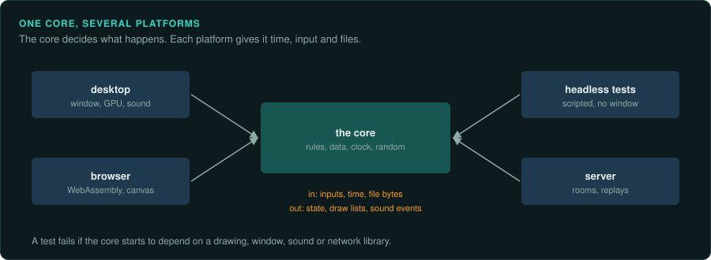
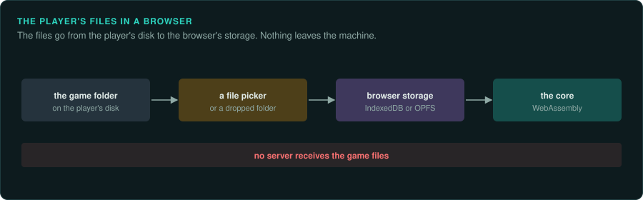
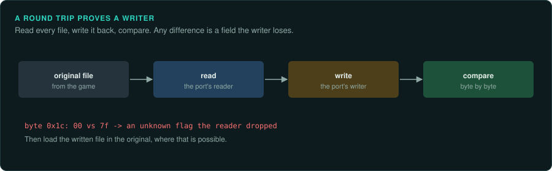

# Building the port

A port has three layers. The core is the game: its rules, its data formats and its simulation,
ported exactly. The platform layer is everything the original got from the machine and the
operating system: a window, drawing, sound, input, time, files. The frame is what the player
sees around the game: a launcher, the library of game files and saves, the settings, a choice
of renderer, help pages and a console.

The core must match the original bit for bit. The platform layer must behave the same as the
original where the player can see it, and can otherwise be built in any good modern way. The
original had no frame. GameFrame provides it, so every port gets the same one, and the core
talks to it only through a versioned contract of events.

This page covers the split, each part of the platform layer, the player's data, the frame,
browser builds and writers for the original's formats.
[re-port](../../skills/re-port/SKILL.md) covers porting the core, and [What a project
can ship](../OUTPUTS.md) the releases.

## The split



- **The core has no platform code.** It does no drawing, plays no sound, opens no window and
  reads no clock. It takes inputs and time from its caller and returns state, draw lists and
  sound events. This is what lets it run in tests, headless, in a browser, on a server and in
  a replay, with the same results everywhere.
- **The core reads data through an interface.** It is given bytes, or a reader for named
  files. It never searches the disk itself.
- **The platform layer is replaceable.** A desktop build, a browser build and a headless test
  harness are three platform layers around one core.
- **Additions sit outside the core.** New features talk to the core through a few documented
  entry points, so the core stays a faithful copy ([re-port](../../skills/re-port/SKILL.md)).
  The frame is one such addition. It reaches the core only through events
  ([The frame](#the-frame)).

## The parts of the platform layer

| Part | What must match the original | What is free |
|---|---|---|
| Time | The fixed step, the tick rate, and what happens when a frame is late: catching up, slowing down, or dropping steps. Pausing when the window loses focus, if the original did | The clock used (a monotonic high-resolution clock), and how the frame rate is chosen |
| Input | When input is read in the frame, key repeat, the mapping of keys and buttons, mouse acceleration and scaling if the original applied its own, and the order of events in one frame ([Inputs](../observe/inputs.md)) | Support for new controllers and remapping, as additions |
| Drawing | The frames: what is drawn, in what order, with what blending ([Drawing](../observe/drawing.md), [Shaders](../hardware/shaders.md)) | The graphics API (wgpu, Vulkan, Metal, OpenGL, Direct3D), higher resolutions and wider screens as marked deviations |
| Sound | The sound logic: which sound plays when, its volume, pan and priority, the music's tempo and transitions. These belong in the core | The mixer, the output device, the latency, the sample rate, as long as the result sounds the same |
| Files | The formats the core reads, and where the original kept saves and settings, if players expect to find them there | How the player's files are found and stored |
| Text | The fonts and the layout, if the original drew its own text | Rendering at higher resolution |

## The player's data

A reimplementation ships no game data. It reads the player's own copy:

- **Find the copy.** Look in the usual places: Steam library folders (listed in Steam's
  `libraryfolders.vdf`), GOG's install folders, the original installer's default path, and a
  folder the player chooses. Remember the player's choice.
- **Check it.** Identify the version from file sizes or hashes, and tell the player clearly what
  was found and what is missing ([Versions](versions.md)).
- **Read it in place.** Prefer reading the original files to converting them. If a conversion
  makes loading faster, keep the converted files in the port's own folder and rebuild them when
  the originals change.
- **Never commit it.** Tests that need game data skip when it is missing. The repository's
  ignore file covers every folder that can hold it ([Legal](../LEGAL.md)).

## The frame

The frame is GameFrame's program around a port. It is the same for every game. The game names
the features it handles, and the frame shows only those. Its pieces are in GameFrame's
`crates/` and `templates/`:

| Piece | What it is |
|---|---|
| [gameframe-frame](../../crates/frame/README.md) | The contract: events and their topics, the manifest, the session both sides share, and the adapters for games outside Rust. It has no user interface and builds for the browser |
| [gameframe-frame-ui](../../crates/frame-ui/README.md) | The frame's views as Dioxus components, for the browser and the desktop |
| [gameframe-library](../../crates/library/README.md) | The player's library: game data, saves and the sections a game opts into |
| [gameframe-launcher](../../launcher/README.md) | The frame in front of a game that a `frame.json` describes, such as a port's own program. No Rust code of the game's own |
| [The library page](../../templates/library-page/README.md) | A plain HTML page for browser ports: the library, design tokens, panels and Markdown pages, set up from one `library.json` |

### What the player sees

| Part | What it does |
|---|---|
| Launcher | Opens on the first run. A "show at start" setting keeps it or skips it later. `--frame` on the command line opens it again |
| Play | The renderers with their grades, start and stop, and what the game reports it is doing. While the game runs, "Back to the game" hides the frame, and the game can open it again from its own menu. When the game ends, the frame comes back, or the program exits to the desktop if the player chose that. "Exit to desktop" leaves at any time |
| Library | The game data, the saves, and the sections the game opts into: mods, screenshots, recordings or its own |
| Settings | One control for each setting in the game's manifest: a toggle, a choice, a range or text, in groups. A setting can say it needs a restart. A choice can list what is on the disc, such as the tracks or the cars: the files that match a pattern, or a list the game sends |
| Setup | The game's hardware, one slot at a time, as the original's Manager or `SETUP.EXE` asked for it: a drop-down for Graphics, then the sound card, the music device or the controller, each with a card beside it for the chosen device. The card shows a grade (exact, good, partial, experimental or missing), how much of its API is done, and its known gaps |
| Renderers | The Graphics slot. For a game with several 3D-card builds, such as Glide, PowerVR and software, one entry for each |
| Help pages | Markdown pages listed in `library.json`. The HTML library page also has panels for news, a changelog, messages, a video and GitHub releases |
| Console | Every event between the frame and the game, the game's controls as buttons, and a line to send any event |

*Exact* is checked against the original, frame for frame. *Good* draws
everything the game uses, with some details different. *Partial* draws most of the game, with
the gaps listed. *Experimental* draws something. *Missing* is listed so the player knows it is
planned.

### The contract

The core and the frame exchange events and nothing else. An event has a topic, a JSON value of
data, and the side that sent it. A topic is two or more lower-case words joined by dots, such
as `game.start`.

| Topic | Direction | Data |
|---|---|---|
| `frame.ready` | frame to game | The saved value of every setting |
| `frame.open`, `frame.close` | either way | Show the frame over the running game, or go back to the game |
| `frame.exit` | either way | Leave the program for the desktop, after stopping the game |
| `config.set`, `config.changed` | frame to game, game to frame | A setting's key and its new value |
| `config.options` | game to frame | The list for a choice whose options come from the game, such as its tracks |
| `render.select` | frame to game | The renderer the player chose |
| `device.select` | frame to game | The device the player chose in another slot, such as the sound card |
| `game.start`, `game.stop` | frame to game | The renderer, the device of every slot, the settings and the arguments |
| `game.status` | game to frame | `loading`, `running`, `paused`, `stopped` or `failed`, with a detail line |
| `input.press` | frame to game | One of the game's controls, pressed or released |
| `library.changed` | frame to game | The library section the player changed |
| `report.new` | game to frame | A place the game reached that the port has not ported, or a crash, from `gameframe-report` |
| `log.message` | either way | A line for the console |

The game describes itself once, in a manifest. The manifest gives the contract version, the
game's name and version, its capabilities, its renderers, its other device slots, its settings
and its controls. The known capabilities are `start`, `renderers`, `devices`, `settings`,
`input` and `library`. The frame draws
a feature only when the manifest lists its capability. A game can list capabilities of its own
and send topics of its own, such as `mygame.ghost.load`. The frame passes those on and shows
them in the console. The contract is version `1.1`, which added the device slots. The frame
refuses a manifest written for a later major version.

### The setup dialog: one pipeline for every game

Games of the 1990s opened a dialog before the game: the Hardwar Manager, POD's set-up, a DOS
game's `SETUP.EXE`. The player chose the 3D card, the sound card and the music device there, and
the dialog started the build or the driver for that hardware. A port does the same through the
frame, in three layers that are the same for every game:

| Layer | What | GameFrame piece |
|---|---|---|
| The dialog | The frame opens first. Play shows one slot per kind of hardware, with the devices the original supported and how complete each is in the port. Start sends `game.start` with `"devices": {"video": "glide", "sound": "directsound"}` | `gameframe-frame` (`device`, `Session::select_device`), `gameframe-frame-ui` (Play) |
| The kernel | The port's own program, started for each game (`Respawn`), reads the launch with `Link::wait`. It works out the devices with `Manifest::resolve`: the pick in each slot, and a device not ported yet replaced by its `stand_in`. One with no stand-in, or an id the manifest lacks, makes the kernel report `failed` with the reason. `Setup::report_gaps` reports each stand-in. Then it builds its renderer and its sound from the ids it uses | `Link`, `Respawn`, `Held`, `Setup` |
| The devices | The cards themselves, modelled once in GameFrame and shared by every game: Glide on `gameframe-voodoo`, the S3D Toolkit's formats in `gameframe-virge`, ATI3DCIF's in `gameframe-rage`, the Sound Blaster, OPL2 and OPL3, the AdLib Gold. For the original's own builds, the replacement libraries in `wrappers/` | `crates/`, `wrappers/` |

The same card has the same id in every game (`gameframe_frame::device::ids`): `software`,
`mmx`, `glide`, `direct3d`, `powervr`, `ati-rage`, `s3-virge` for graphics; `none`,
`directsound`, `maxi-sound-64`, `sound-blaster`, `pc-speaker` for sound; `adlib`, `opl3`,
`adlib-gold`, `game-blaster`, `tandy`, `general-midi` for music. `device::known(id)` names the
crate or wrapper that models each. A game's own device, one GameFrame does not know, takes an
id of its own.

List every device the original supported, even the ones the port lacks: a `missing` device
tells the player it is planned. Give such a device a `stand_in`, a device of the same slot the
port has, such as `software`. The game then starts with it, and the kernel reports the gap
with `gameframe_report::unported!`. Every choice in the dialog runs the game end to end, and
the reports say which devices players want first. Keep the original's own settings for a device (sample rate,
colour depth) as ordinary settings in a group named after the slot.

### One program or two, one build or many

The originals often shipped one build per 3D card. POD Gold has 14 executables. They draw in six
ways, each in a Pentium and an MMX build. Each card's SDK was linked in when the game was
built, and each CPU path was compiled on its own. A port has no such limit. Each device is a
module behind one interface, and a card's model is a crate (`gameframe-voodoo` for Glide). So
make **one build that holds every device**, and let `game.start`'s `devices` choose one at the
start. A build with one device left out is for a target that cannot take it, such as the
browser, or a size limit. Leave the device out with a Cargo feature, and leave it out of the
manifest too, or grade it `missing` with a stand-in.

The frame and the game run as **two processes on the desktop**. Each wants the main thread
for its event loop: the frame through tao and wry, the game through winit. On macOS only one
can have it. A winit event loop can also be made only once in a process, so `Respawn` starts
the kernel again for each game. Two processes do not need two files. The game's executable can
hold both roles: with no arguments it opens the frame, and the frame starts the same file again
with `--frame-io` (`std::env::current_exe()`) as the kernel. That needs the player as a library
that the launcher's crate calls, and it brings Dioxus into the game's build. Until a game wants
one file, keep the launcher in its own Cargo workspace beside the game's executable, as POD's
and Hardwar's are.

In the browser there are no processes. The kernel implements `Game` and runs in the frame's
page, so the same type serves both: JSON lines on the desktop, calls in the browser.

### Three ways to join

| Way | For | What the game provides |
|---|---|---|
| Rust | A port written in Rust | A type that implements the `Game` trait: `manifest`, `on_event` and `poll` |
| JSON lines | A port in any other language | A program that prints its manifest as its first line. It then reads events on standard input and writes events on standard output, one JSON object per line. Its standard error goes to the console |
| Config only | A game the frame starts as a separate program | A `frame.json` with the manifest, the start command and the game's folder. The frame fills `{renderer}`, `{device:SLOT}` and `{setting:KEY}` in the command's arguments. [gameframe-launcher](../../launcher/README.md) runs it with no Rust code of the game's own. Such a game cannot open the frame while it runs: the frame comes back when it ends |

`Demo` in gameframe-frame stands in for a game, so the frame runs with none.

### Reports from the running game

A port names each path it has not ported with `gameframe_report::unported!`. The first time the
game reaches one, or crashes, [gameframe-report](../../crates/report/README.md) writes a report:
the place in the port, the original's address, the values there, the game's state, the launch
and the devices. A debug build keeps the reports on the machine for an agent to read (Dev). A
release build gives each one a link to a filled-in GitHub issue, which the frame lists in Play
(Production). `tools/triage/report_issue.py` lists the local reports and files one, once per
place. Each issue's body tells an agent where to start.

### The frame's look

The frame takes its look from the library page's design tokens. One `library.json` sets the
colours, fonts, pictures and icons of the HTML page and of the Dioxus views. Every class starts
with `lib-`. The [library page's README](../../templates/library-page/README.md#the-design-system)
lists the tokens and the components.

### Libraries below the contract

Reusable libraries plug into the core. The frame never sees them. The
[crates](../crates/README.md) give the core a chip or a runtime exactly as the original had it:
OPL2 music, MSVC's maths, Turbo Pascal's `Real`. `gameframe-game-source` and
`gameframe-disc-image` read the player's files from a folder or a CD image. The
[replacement 3D-card libraries](../hardware/wrappers.md) run the original's own per-card builds
on a modern machine.

### Planned

- The project viewer (`re-browse`) as a tab of the frame.

When a game needs something the frame lacks, such as a kind of setting, a topic or a panel, add
it to GameFrame with a pull request and a test, or open an issue. Keep the game's own part in
the game's repository.

## Browser builds



A core written in Rust, C or C++ compiles to WebAssembly and runs in the browser on the
player's files. Points to plan for:

- **Files.** The page asks for the game's folder or files (a file picker, a dropped folder, or
  the File System Access API where the browser has it), and keeps them in the browser's own
  storage (IndexedDB or the origin private file system). Nothing is uploaded. GameFrame's
  [library page](../../templates/library-page/README.md) does this with no edits to its code. It
  is a plain HTML page set up from one `library.json` with the game data, the saves, opt-in mods
  and other sections, design tokens, news panels and help pages. The
  [gameframe-library](../../crates/library/README.md) crate reads the same files from the game,
  in the browser and on the desktop. A disc image read in place goes through
  [gameframe-game-source](../../crates/game-source/README.md).
- **The main loop.** The browser calls the page once per display frame (`requestAnimationFrame`).
  The port cannot block or wait, so loading and long jobs must be split into steps or moved to
  a worker.
- **Threads.** WebAssembly threads need shared memory, which needs the page to be served with
  cross-origin isolation headers. Without them, the port runs on one thread.
- **Memory.** 32-bit WebAssembly can use at most 4 GB, and less on some devices. Share assets
  between instances, free what is no longer needed, and measure.
- **Sound.** Browsers start audio only after the player clicks or presses a key. Start the
  audio context on the first input.
- **The same results.** Basic floating-point operations give the same results in WebAssembly
  as natively, but the maths library may differ. A core that uses its own copies of the
  original's maths functions computes the same game in both. Test it: run the same inputs
  natively and in the browser and compare the state.

## Writing the original's formats



Editors, mod tools and save converters write files in the original's formats. Prove each
writer with a round trip: read every file of that kind, write it back, and compare the bytes.
Every difference is a field the writer does not keep (padding, an unknown flag, a value
rounded on the way). Then load the written files in the original, where that is possible.

## Building and releasing

- Build for every system the project supports on each change, with continuous integration, and
  run the tests that need no game data there.
- Version the port separately from the game it copies, and show both where players look
  ([What a project can ship](../OUTPUTS.md)).
- Install a release build on this computer with `./gameframe install` (below).
- Measure performance on the slowest system you support. Profile before changing anything,
  and check that an optimisation leaves the game's results unchanged.

### Installing a build on this computer

`./gameframe install` builds the port's release programs and installs them as an application
the player can open from the Finder, the Start menu or the desktop's menu. It reads
`install.json` at the project's root (`gameframe tool install_app` lists every key):

```json
{"name": "Un-POD", "id": "dev.gameframe.unpod", "version": "0.1.0", "icon": "apps/icon.png",
 "vanilla": {"build": [["cargo", "build", "--release", "-p", "unpod", "-p", "pod-frame"]],
             "programs": ["target/release/unpod", "target/release/pod-frame"],
             "start": "pod-frame", "args": ["--data", "{data}"]},
 "extra":   {"build": [["cargo", "build", "--release", "-p", "unpod", "-p", "pod-frame",
                        "--features", "extras"]]}}
```

- **Vanilla** is the game with the frame only. The frame's `--no-frame` and `--frame` turn its
  window off and on again, and the port's `--vanilla` switch still applies.
- **Extra** is the same programs built with the additions on (hooks, capture, input, renderers,
  mods). `./gameframe install extra` installs both, the second as "NAME Extra", each with its
  own data folder.

| System | Programs | Data |
|---|---|---|
| macOS | `/Applications/GameFrame/NAME.app` (`~/Applications/GameFrame` when `/Applications` is not writable) | `~/Library/Application Support/GameFrame/NAME` |
| Windows | `%LOCALAPPDATA%\Programs\GameFrame\NAME`, with a Start menu shortcut | `%APPDATA%\GameFrame\NAME` |
| Linux | `~/.local/share/GameFrame/NAME`, with a menu entry | `~/.config/GameFrame/NAME` |

The GameFrame folder is made when it is missing. The program starts in its data folder, so a
port that keeps its files in the current folder keeps them there, and `{data}` in `args` names
it. A new install replaces the programs and never touches the data. `--list` shows what is
installed, and `--dry-run` shows what would happen.

Build each system's install on that system. The macOS bundle is signed ad hoc, which is enough
on the Mac that built it. Another Mac asks before it opens it, because it has no Developer ID
signature. For players on other computers, make a release with continuous integration.
