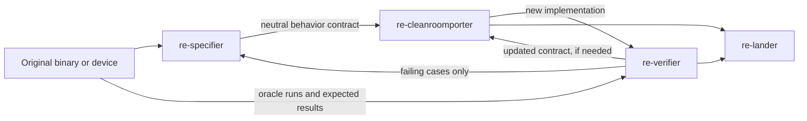

# Clean-room-style implementations

This guide describes a source-visible specification role and a source-blind implementation
role. It turns an original program's behavior into a neutral contract, then gives that contract
to a fresh implementer. Use this method when independent implementation is a project requirement
or when keeping source analysis away from implementation improves the work.

This process records who could see each artifact and what each role received. Separate agent
tasks and prompts create a useful working boundary. They do not create an access control boundary
when every task can read the same files or machine. Record that limit accurately. The project
owner chooses the method and the license for the resulting work.

## Roles and information flow

| Role | May see | Must produce |
|---|---|---|
| `re-specifier` | The original binary, permitted documents, disassembly and runtime observations | A behavior contract and a separate evidence ledger. It does not write implementation code. |
| Coordinator | The hand-offs and project state | A clean packet containing only the contract and approved public inputs. It does not forward source snippets or source-specific explanations. |
| `re-cleanroomporter` | The clean packet, the new codebase, public specifications and project build instructions | New code written from the contract. It does not inspect original artifacts or the source evidence ledger. |
| `re-verifier` | The implementation and a controlled way to run the original or another oracle | Test vectors and observed outputs. It reports differences as cases and values, not source explanations. |
| `re-lander` | The implementation, contract, evidence ledger and verification report | A clear record of scope, provenance, implementation status and remaining unknowns. |

Do not reuse the source reader's conversation as the implementer's context. Start the implementer
with a fresh task. A separate worktree or packet is stronger than relying on a prompt when the
source files remain visible in the same checkout. A separate human team and technical access
controls are needed when a project requires stronger separation than task-level isolation.

## Build the contract

1. Define one bounded behavior. Include the binary and version, calling interface, input range,
   expected state, outputs and the behavior the implementation must reproduce.
2. Have `re-specifier` trace only that behavior. It records evidence in the project's private
   analysis area. It uses evidence IDs such as `E01` in the contract, then keeps addresses,
   tool commands and source observations in the separate ledger.
3. Describe behavior in tables, state transitions, constraints and input/output examples. Do
   not include source code, pseudocode, decompiler output or a line-by-line translation.
4. Mark each claim *observed*, *measured*, *inferred* or *unknown*. Keep unknown behavior
   explicit. Give each unknown a software-only probe when one is available.
5. Record ordering, callbacks, state lifetime, error results and side effects. These details
   often sit at a library or driver boundary and can be missed by a chip-only description.
6. Use [the contract template](../../skills/re-cleanroom/references/contract-template.md) and
   [the packet checklist](../../skills/re-cleanroom/references/packet-checklist.md).

The evidence ledger lets a later reviewer trace a contract claim to its source. Keep it outside
the implementer's packet. The implementer does not need source addresses to reproduce a behavior.

## Prepare the source-blind hand-off

Before sending the contract, list every file the implementer may read. Include the contract,
public interface specifications, the new project's own crate or API conventions, permitted
build instructions and synthetic test vectors. Exclude the binary, extracted driver files,
disassembly, Ghidra exports, source notes, private evidence ledgers and earlier source-informed
implementations.

Record the packet's file list and SHA-256 values in its manifest. If the project uses the same
checkout for both roles, say that the boundary is procedural and ask the implementer to read only
the allow-listed files. Do not describe that setup as technically isolated.

## Implement and resolve gaps

The source-blind implementer (`re-cleanroomporter`) uses only the packet and public material. It
builds new code in the project's requested license. It does not copy from a reference
implementation, even when the project owner controls that code, if this task is being run as
source-blind work.

If the contract omits behavior, the implementer writes an exact question and stops that slice.
The coordinator sends the question to the source-facing role. That role updates the contract and
evidence ledger, then the coordinator creates a fresh implementation task with the revised
packet. The implementer receives the missing behavior, not the source agent's reasoning.

Keep models bounded when the original delegates to another driver, operating-system service or
hardware layer. A wrapper contract does not prove the behavior of the provider behind it. Name
that boundary and leave a software-only probe for the next layer. Physical hardware is optional
when a software reference or a documented observable boundary can answer the question.

## Verify without breaking the split

The verifier checks the new code against the behavior contract and runs controlled comparisons
against the original where possible. For each mismatch, report the input, expected result and
actual result. Do not send decompiled explanations to the implementer.

If a mismatch reveals missing behavior, the source-facing role updates the contract. The
implementer then works from a fresh packet. The verifier can also check code against the
contract without seeing the original, but that check alone does not establish parity.

Do not block a bounded implementation on physical hardware. Record which software checks ran,
which reference they used, and the remaining uncertainty. Do not claim the whole device or driver
is complete when only one API path or provider layer was implemented.

## Emulator and debugger options

Use the tool that answers the question. GameFrame already provides several parts of this setup.

| Tool | Useful for | Current limit |
|---|---|---|
| Ghidra and REA | Static binary review, calls, imports, strings, and focused decompilation | Static evidence does not prove runtime provider binding or hardware output. |
| DOSBox-X debugger | DOS execution, breakpoints, memory and port inspection; GameFrame has scripts and an MCP debugger channel | It is strongest for DOS paths. It is not a Windows 3.x driver debugger. |
| 86Box | Reproducible period PC profiles and Windows 3.x guests; keep a clean base and run installations in clones | GameFrame has no 86Box control MCP adapter today. A GDB-stub build is an optional, experimental route and must be checked against the local build. |
| Windows 3.1 SDK tools | CVW and WDEB386 are documented for Windows 3.1 driver debugging | Tool media and the required second-monitor or serial setup have not been confirmed in every VM profile. |
| Guest-side logging probe | Capture API calls, provider callbacks and virtual port writes for one test case | It needs a small project-specific harness or service substitute. |

The [debugger guide](../observe/debuggers.md), [86Box guide](../observe/86box.md) and
[environment guide](environments.md) have setup details. DOSBox-X's live debugger supports
breakpoints and command execution. The current tools include commands for breaks, breakpoints,
debugger help, execution, snapshots and connectivity checks. See the
[DOSBox-X command reference](https://dosbox-x.com/wiki/DOSBox%E2%80%90X%E2%80%99s-Supported-Commands).

86Box's [advanced-build guide](https://86box.readthedocs.io/en/latest/dev/builds.html) covers
source-built variants. A maintainer has described the optional GDB stub in a
[project discussion](https://github.com/86Box/86Box/discussions/7090). Treat it as a candidate
for software debugging, not as a ready GameFrame integration. The archived
[Windows 3.1 DDK guide](https://f6.erista.me/files/bitsavers/pdf/microsoft/windows_3.1/Microsoft_Windows_3.1_SDK_1992/PC29131-0392_Windows_3.1_Device_Driver_Kit_Installation_Mar92.pdf)
lists CodeView for Windows and WDEB386. The archived
[Windows Programming Tools guide](https://www.bitsavers.org/pdf/microsoft/windows_3.1/Windows_3.1_Programming_Tools_1992.pdf)
documents WDEB386's serial-terminal connection. Confirm the available tool media and VM wiring
before investing in setup.

The repository's `.mcp.json` defines servers for REA, DOSBox-X and GameFrame's discovery service.
They cover separate parts of the workflow, and a configured server may not have a live process
attached. Check connection status before using live commands.

MCP should become the agent-facing surface for the full GameFrame toolchain. The target is to
cover every stable GameFrame capability and make configured external tools discoverable through
the project's MCP setup. This includes inventory and triage, binary analysis, format decoding,
emulation and observation, debugger control, verification, clean-room packet handling and project
records. Each operation should report its inputs, connection state, output paths and evidence
provenance. Long-running work should report progress and support cancellation. Keep the command
line tools available, with MCP operations calling the same underlying implementations.

Grow coverage in phases. Start with reliable emulator and debugger control, including an 86Box
adapter when its control protocol can be tested. Then fill gaps across the remaining tools and
configured MCP providers. Project configuration should let agents discover which tools are
available for that machine and task.

## Lessons from the audio-driver work

- Split the work by observable API path. Open, query, update, queue, completion, MIDI, mixer and
  synth calls can have different contracts even when one driver file exports them.
- Keep the card model, Windows wrapper and lower service as separate layers. A wrapper's
  callback or status result does not establish the chip's register behavior.
- Record shared state and call guards in the contract. Small global fields can affect calls
  across multiple selectors.
- Capture a clean operating-system snapshot before installing the driver. Use a disposable
  clone for each configuration change and record the emulator profile and file hashes.
- Treat missing emulated components as a test limitation, not as evidence that the higher-level
  API cannot be modeled. State which path still loads and what remains unknown.
- Prefer a reproducible software probe over waiting for physical hardware. A logging provider,
  API harness or virtual port trace can settle many call-boundary questions.

The audio work used separate source-specification and implementation tasks. The tasks shared a
host and repository, so the record should call this source-blind, clean-room-style implementation,
not claim a technically enforced or legally conclusive clean room.

## Completion record

For each slice, keep these items with the project:

- The contract, its scope and its unknowns.
- A separate evidence ledger with original artifact hashes and source locations.
- The packet manifest and the exact contract version received by the implementer.
- The implementation commit and its stated license.
- The verifier's test vectors, observed results and limits.
- Any deviation, unsupported path or suggested software-only probe.

Update [the project checklist](../working/writing.md) or the project's equivalent. Hand the code
to `re-lander` after the verifier reports what is established and what remains open.
