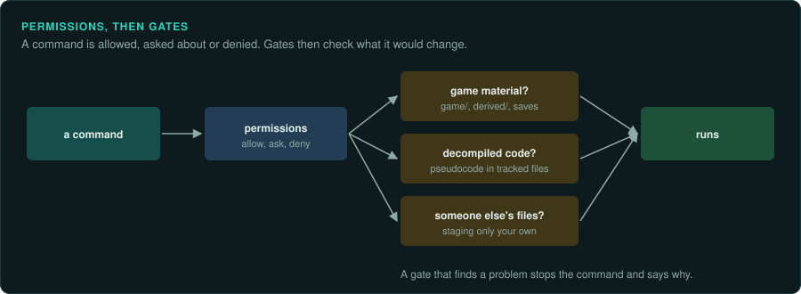

# Permissions and gates

GameFrame and every project made with `scripts/new-project.sh` come with gates. A gate is a
small check that runs before a commit, a push or a file write. It stops the few mistakes that
cost the most: game material in git, decompiled code in tracked files, and commits by agents
that should hand off instead. The gates run in git itself, so they protect people and every
agent. Each agent's own hooks add earlier checks, and permissions decide what runs without a
prompt.

Gates are a safety net for honest mistakes. They are not a security boundary. A person or an
agent that means to get around them can. The rules in `AGENTS.md` and the skills still apply
in full.

## What the gates check

The checks live in `scripts/hooks/gates/checks.py`. They know nothing about any agent.
`scripts/hooks/gate.py` is the command that every hook calls. A gate that blocks exits with
status 2 and writes the reason on stderr. Git and every agent below treat that as a refusal and
show the reason. In every other case the gate exits 0 and changes nothing.

| Check | It blocks |
|---|---|
| Commit | Staged files in `target/`, `analysis/`, `derived/`, `game-data/` or `save-game/`. Staged game binaries and data files (`.exe`, `.dll`, `.ovl`, `.pkg`, `.sav`, `.wad`, `.pak`, ROM images and others). Added lines that look like Ghidra's decompiled code. A commit made by a GameFrame agent other than `re-lander`. |
| Push | A push made by a GameFrame agent other than `re-lander`. |
| Write | Writing two or more lines of decompiled code into a file outside `analysis/`, `derived/` and `target/`. |

### What counts as decompiled code

Ghidra's decompiler writes names and forms that people do not write by hand.
The gates look for these: `undefined4`, `CONCAT44(`, `SUB41(`, `ZEXT14(`, `(**(code **)`, `/* WARNING: `, and variables such as `unaff_EBX`, `in_stack_00000008` and `extraout_EAX`.
One such line can appear in prose that explains a type. Two or more lines in one write or one
commit are blocked.

Function addresses such as `FUN_1400be770`, offsets such as `+0x44` and constants pass. They are
how findings cite the original.

### Which agents may commit

Only `re-lander` commits and pushes. The other stage and task agents end with a hand-off that
names the next agent. When an agent such as `re-tracer` tries to commit, the gate tells it to
hand off to `re-lander`. The main session and people are not GameFrame agents, so they can
commit and push.

The gate learns which agent is running in one of three ways, in this order:

1. Claude Code puts the subagent's name in the hook input (`agent_type`).
2. The environment variable `GAMEFRAME_AGENT` holds the agent's name, such as `re-tracer`.
3. The shell command starts with it: `GAMEFRAME_AGENT=re-tracer git commit -m "..."`.

The other agents have no field for the subagent, so their agent files set the variable on the
command. With none of the three, the gate treats the commit as the main session's.

## The git hook

`scripts/hooks/git/pre-commit` runs the commit check inside git, with no agent at all. It runs
`gate.py staged`, which reads the commit's index and `GAMEFRAME_AGENT`. It catches commits from
a terminal, from an editor and from any agent, including `git commit -a`.

- In GameFrame, `scripts/setup.sh` sets `git config core.hooksPath scripts/hooks/git`.
- In a project, `scripts/new-project.sh` copies the hook to `.githooks/pre-commit` and sets
  `core.hooksPath .githooks`. In a plugin project the hook finds GameFrame through
  `./gameframe root` (or `GAMEFRAME_ROOT`). In a project made with `--copy` it uses the project's
  own `scripts/hooks/gate.py`.
- `scripts/setup.sh` (and `./gameframe doctor`) sets `core.hooksPath` only when it is unset. When
  you already use a hooks folder of your own, it says so and leaves it. Call the GameFrame hook
  from your own `pre-commit` to keep both.
- When the hook cannot find `gate.py`, it warns and lets the commit through.

Git does not run hooks from a fresh clone until `core.hooksPath` is set, so run
`scripts/setup.sh` (or `./gameframe doctor`) once after cloning. `git commit --no-verify` skips
the hook for one commit. The hook checks commits only. The push rule runs in the agents' hooks.

## Each agent's hooks

The agent hooks run earlier than git, before the tool call. They also check file writes, which
git never sees until a commit. Each agent has its own input format, so `gate.py` takes the
agent's name and reads that agent's fields (`scripts/hooks/gates/adapters.py`). The formats
below follow each agent's documentation as of October 2026.

| Agent | Config file | Event | What is checked |
|---|---|---|---|
| Claude Code | `hooks/hooks.json` (the plugin), `.claude/settings.json` | `PreToolUse` on `Bash`, `Write`, `Edit`; `SessionStart` | Commit, push, write; a session note |
| Codex | `.codex/hooks.json` | `PreToolUse` on `Bash` and `apply_patch` | Commit, push; write (the added lines of each file in a patch) |
| Gemini CLI | `hooks/gemini-settings.json`, merged into `.gemini/settings.json` | `BeforeTool` on `run_shell_command`, `write_file`, `replace` | Commit, push, write |
| Cursor | `.cursor/hooks.json` | `beforeShellExecution` | Commit, push |
| GitHub Copilot | `.github/hooks/gameframe.json` | `preToolUse` (`bash`) | Commit, push |

### Claude Code

The plugin brings the hooks in `hooks/hooks.json`. GameFrame itself, and projects made with
`--copy`, also list them in `.claude/settings.json`. Each hook calls one gate: `gate.py commit`,
`push`, `write` or `session`. The hook's `if` field picks out `git commit` and `git push`. The
`session` gate adds a short note to the start of a session: whether `.env`, `.venv` and the
Ghidra export exist, and the next three open items in `docs/CHECKLIST.md`.

### Codex

`.codex/hooks.json` runs `gate.py codex` before `Bash` and `apply_patch`. Codex loads a
project's hooks only when the project is trusted, and asks you to review each new or changed
hook with `/hooks` before it runs. For `apply_patch`, the gate reads the patch text and checks
the `+` lines under each `*** Add File:` and `*** Update File:` header.

### Gemini CLI

Gemini CLI reads hooks from `.gemini/settings.json`. GameFrame ships its entry as
`hooks/gemini-settings.json`. Copy its `hooks` section into `.gemini/settings.json`, or merge it
with the settings you have. It runs `gate.py gemini` before `run_shell_command`, `write_file` and
`replace`.

### Cursor

`.cursor/hooks.json` runs `gate.py cursor` before shell commands that contain `git`. Cursor's
documentation gives no file fields for a hook that runs before a write. Its `afterFileEdit`
hook runs after the file is written and cannot stop it. So Cursor's writes are checked only at
commit, by the git hook.

### GitHub Copilot

`.github/hooks/gameframe.json` runs `gate.py copilot` before every tool call. The gate acts only
on `bash` calls that commit or push. Copilot's documentation gives no argument fields for its
`edit` and `create` tools, so writes are checked only at commit, by the git hook. Copilot denies
the tool call when a `preToolUse` hook fails, so `python3` must be on the path.

## Permissions

Permissions decide which commands run without a prompt. Each agent has its own system. GameFrame
ships Claude Code's lists. For the others, the table below says where the same choices live. Set
them up for your own agent and project.

Claude Code checks the deny list first, then the ask list, then the allow list. A command on
none of the lists follows the session's permission mode.

| List | Commands | Why |
|---|---|---|
| Allow | `./gameframe`, the scripts in `scripts/` (Ghidra export and run, DOSBox, the installer extractor, `setup.sh` without `--install`), `tests/run.sh`, the tools under `.venv/bin/python tools/` and `truth/` | The toolkit's own commands. They read the game and write only to ignored folders. |
| Allow | `git status`, `diff`, `log`, `show`, `add`, `commit`, `pull` | Every slice ends with a commit. The commit gate checks each one. |
| Ask | `git push` | A push publishes the work. The user sees each one. |
| Ask | `scripts/setup.sh --install`, `brew install`, `cargo install`, `npx -y rea-agents@6.4.0 setup`, `sudo`, `curl`, `wget` | These install software or download files. The project asks before any download. |
| Deny | `git add -f`, `git add --force`, `git push --force`, `git push -f` | A forced add is the usual way game material reaches git. A forced push can destroy another session's work. |

Everything else, such as reading files, running `cargo`, `objdump` or `python3`, is left to the
session's mode. The lists do not try to name every tool an agent may need.

| Agent | Where the same choices live |
|---|---|
| Claude Code | `permissions.allow`, `ask` and `deny` in `.claude/settings.json`. |
| Codex | `sandbox_mode` (`read-only`, `workspace-write`, `danger-full-access`) sets what commands can touch. `approval_policy` (`on-request`, `never`, or a granular policy) sets when Codex asks. Execution-policy rules allow, prompt for or forbid single commands. Both settings live in `config.toml`. |
| Gemini CLI | The policy engine. Rules in TOML files under `~/.gemini/policies/` match a `toolName`, a `commandPrefix` or a `commandRegex`, and give a `decision` of `allow`, `ask_user` or `deny`. Workspace policy files are not read yet, so the rules live in your user folder. |
| Cursor | The agent's command allowlist in Cursor's settings, and its run mode. |
| GitHub Copilot | The tools you allow or deny when you start the CLI, and the `permissionDecision` a `preToolUse` hook returns. |

To match GameFrame's Claude lists elsewhere: allow the toolkit and the everyday git commands, ask
before `git push` and before installs or downloads, and deny forced adds and forced pushes.

## Changing them

Put personal additions in `.claude/settings.local.json`, which git ignores. Claude Code merges
its lists with the ones in `.claude/settings.json`. An entry there can allow more commands. It
cannot undo an ask or a deny entry from the shared file, because deny and ask are checked first.
To change those for everyone, edit `.claude/settings.json` in the project. To turn a gate off
for one project, remove its entry from that agent's hook file, or unset `core.hooksPath` for the
git hook.

When a gate blocks something that is correct, change the gate rather than working around it.
Add a test for the case to `tests/run.sh`, in the section named "Gates".
