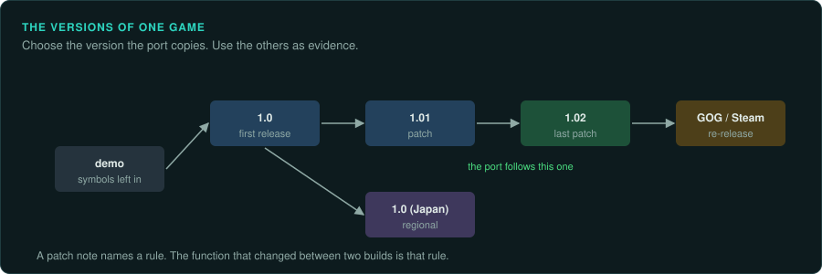

# Versions, patches and builds

Most games exist in several versions: the first release, patches, regional releases, budget
re-releases, digital store builds, ports to other systems, and demos. They differ in rules,
bugs, data and code. A reimplementation must choose which version it copies, and it can use
the other versions as evidence. This page covers choosing the version, comparing builds,
and keeping a port faithful to one version while it reads the data of several.

## Find every edition first

Before deep work, list every edition of the game: the first release, regional releases with
other languages, budget and "Gold" re-releases, patches and official updates, store builds,
ports, demos, and what came with each (manuals, readmes, extra tracks or levels, tools). Look in
the game's own readme and manual, the publisher's old web pages, archive sites, magazine cover
discs, store pages and fan sites, and note each edition's date. A month of work on one edition
can be checked again on a newer one, but a newer edition found late costs that month again.

Record what you find in `docs/versions.md` (the project template has the table): each edition
with its source and checksums, its languages, content and builds, the data and code deltas
between editions, the extras, and which edition is the reference.

```bash
.venv/bin/python tools/triage/versiondiff.py target/first/POD.CUE target/gold/POD.CUE > derived/versions-data.md
```

`versiondiff.py` compares two editions, as folders or as disc images read in place: files
added, removed and changed by folder, the executables' link dates, and the languages each has.
Its Markdown goes into the data-delta section. The code delta comes from the Ghidra exports of
both, with `match_functions.py` (below).

## Choosing the version



Decide this at the start and record the decision in `docs/versions.md`. GameFrame's default is
**the last version released**: it has the most fixes and improvements, and it is usually the
one players own. Choose another for a reason, and write the reason down:

- **The version players have.** Usually the last official patch, or the version sold today in
  digital stores. Players expect the port to read their copy.
- **The version the community plays.** Speedrunners and competitive players often prefer one
  release for its bugs or timing. If the port is for them, copy that one.
- **The most complete version.** A later edition may add content and fix bugs, but it may also
  change rules.
- **The version with the most evidence.** A build with symbols or debug information is the
  easiest to study, even if the port then follows a different build. Study one and port
  another only where the code is the same, and check each difference.

Record the exact build: the file hashes (`tools/triage/compare_trees.py` and
`tools/triage/fixity.py`), the version string, and the build number the game shows.

## Comparing two builds

| Question | How |
|---|---|
| Which files changed? | `tools/triage/compare_trees.py OLD NEW` compares two copies file by file. `--similar` says how much of each changed file is shared, and pairs files that were renamed |
| How much of a file changed? | `tools/triage/similar.py` measures what two binaries share, even when everything has moved |
| Which functions are the same? | `tools/triage/match_functions.py` matches the functions of two Ghidra exports and carries your labels to the new build. BinDiff and Diaphora do the same inside a disassembler |
| What changed in one function? | Compare the two pseudocode listings. Most changes are a constant, a new condition or a new call |
| What did the developers say changed? | Patch notes and readme files. Each line is a lead: find the function it describes in both builds |

A patch note such as "fixed archers firing through walls" names a rule and gives two builds that
differ in it. Comparing the two functions shows the original rule and the fix. The chosen version
decides which of the two the port has.

## One port, several versions

A port may need to read the data of several versions even when it copies the rules of one:

- Detect the version from the files the player gives it (file sizes, hashes, a version string),
  and tell the player which version was found.
- Keep the rules of the chosen version. Where another version differs and the project wants it,
  add it as an option, marked as a deviation, never silently.
- Saves from different versions may differ. Test the port with saves from each version it
  claims to read.

## Moving to a newer version mid-project

A newer edition can turn up after weeks of work ([know-how](../knowhow/context-newer-edition-mid-project.md)).
Moving the project to it keeps the work, if it is done in this order:

1. **Record both editions** in `docs/versions.md`: sources, checksums, dates, and the data delta
   from `versiondiff.py`.
2. **Export the new binaries** with `scripts/ghidra-export.sh`, beside the old export.
3. **Match functions so the labels carry over**: `match_functions.py analysis/export/OLD
   analysis/export/NEW --labels labels/names.tsv --out labels/NEW/names.tsv`. Review the fuzzy
   matches the port depends on, then apply the labels (`ghidra-run.sh NEW labels ...`). Keep the
   map from old to new addresses (`labels/NEW/map.tsv`): every finding that cites an old address
   can then be found again.
4. **List what changed in the code**: functions matched and identical, matched and changed, new,
   and gone. Read each changed function the port uses, and write what changed in the code-delta
   section.
5. **Run the readers over the new data** with `validate.py`, and fix each format variant.
6. **Record the ground truth again** on the new edition: emulator measurements
   (`re-emulate`) and recordings of whole runs (`docs/observe/recording.md`). Patches made for
   the old edition check its bytes, so the new edition needs its own.
7. **Verify the port again** against the new truth (`re-verify`). A test that passes on both
   editions needs no note; one that differs is a change between editions.
8. **Keep the old edition as documented differences**: what the old edition did, where the new
   one differs, with both addresses. A port can offer the old behaviour as an option, marked as
   a deviation.

## Demos and prototypes

Demos, betas and prototypes are builds too. They often ship with debug symbols, logging or
debug menus that the release removed, and their code is often close to the release. Use them as
evidence, matched to the release with `match_functions.py`, and keep their material in the
project's ignored folders, like any game material ([Legal](../LEGAL.md)).
